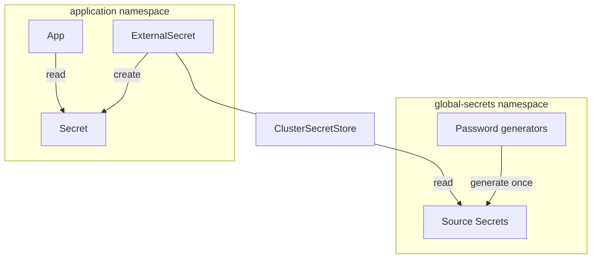

# Secrets management

## Overview

- Global secrets are stored in the `global-secrets` namespace.
- Integrate with GitOps using [External Secrets Operator](https://external-secrets.io).
- Secrets that can be generated are automatically generated and stored in the `global-secrets` namespace.

!!! info

    Despite the name _External_ Secrets Operator, global secrets are created in the same cluster and synced
    to other namespaces using the [Kubernetes provider](https://external-secrets.io/latest/provider/kubernetes).

    While not supported by default in this project, you can also use other external providers such as HashiCorp Vault,
    AWS Secret Manager, Google Cloud Secret Manager, Azure Key Vault, 1Password, etc.



## Generated secrets

Random secrets (admin passwords, OAuth2 client secrets) are listed in `platform/global-secrets/values.yaml`. For each one, an external-secrets `Password` generator creates a Secret in namespace `global-secrets` once, and the `global-secrets` ClusterSecretStore shares it with the apps that reference it.

```yaml title="./platform/global-secrets/values.yaml"
--8<--
./platform/global-secrets/values.yaml
--8<--
```

They are never rotated automatically: both sides of a client secret would have to restart together, and admin passwords are stored in the app's database on first start.

To rotate one by hand:

1. `kubectl -n global-secrets delete secret <name>`. external-secrets generates a new value.
2. Restart every app that uses it (for example `kubectl -n forgejo rollout restart deploy/forgejo`).
3. For an admin password, also change it inside the app to the new value.

Kanidm OAuth2 client secrets are generated by the kaniop operator instead, as `<client>-kanidm-oauth2-credentials` in the client's namespace.

## Extra third-party secrets

For third-party secrets that you don't control, add them to `external/terraform.tfvars` under the `extra_secrets` key,
then run `make external`.

They will be available as a Secret named `external` in the `global-secrets` namespace.
You can use it with `ExternalSecret` just like any other global secret.

## How secrets are pulled from global secrets to other namespaces

When you apply an `ExternalSecret` object, for example:

```yaml hl_lines="4 21-23"
apiVersion: external-secrets.io/v1
kind: ExternalSecret
metadata:
  name: forgejo-admin
  namespace: forgejo
spec:
  data:
  - remoteRef:
      conversionStrategy: Default
      key: forgejo.admin
      property: password
    secretKey: password
  refreshInterval: 1h
  secretStoreRef:
    kind: ClusterSecretStore
    name: global-secrets
  target:
    creationPolicy: Owner
    deletionPolicy: Retain
    template:
      data:
        password: '{{ .password }}'
        username: forgejo_admin
      engineVersion: v2
```

This will create a corresponding Kubernetes secret:

`kubectl describe secrets -n forgejo forgejo-admin`

```yaml hl_lines="1 8-11"
Name:         forgejo-admin
Namespace:    forgejo
Labels:       <none>
Annotations:  reconcile.external-secrets.io/data-hash: <REDACTED>

Type:  Opaque

Data
====
password:  32 bytes
username:  13 bytes
```

Please see the official documentation for more information:

- [External Secrets Operator](https://external-secrets.io)
- [API specification](https://external-secrets.io/latest/spec)
