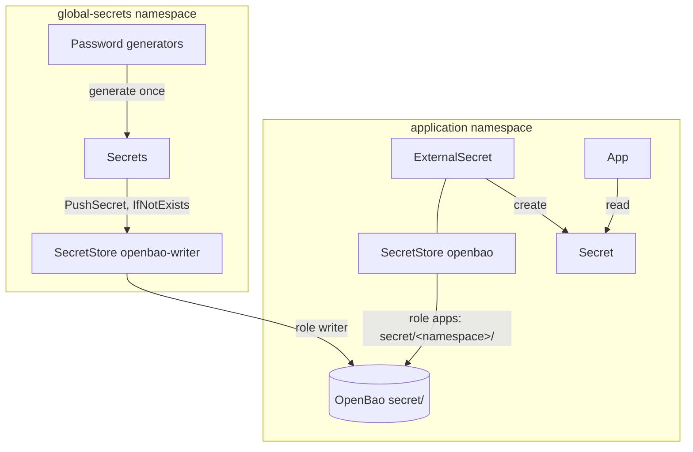

# Secrets management

## Overview

- [OpenBao](https://openbao.org) (`platform/openbao`) holds the cluster's secrets in its KV store `secret/`.
- Every namespace reads its own branch, `secret/<namespace>/<name>`, through its `SecretStore` `openbao`
  (`system/secret-store`, rendered by every Application) and [External Secrets](https://external-secrets.io)
  `ExternalSecret`s. OpenBao refuses a read of another namespace's branch.
- Generated secrets come from `platform/global-secrets`, which pushes each one to its readers' branches, under
  `secret/<namespace>/generated/`: the only paths it can write.



## Reading a secret

```yaml
apiVersion: external-secrets.io/v1
kind: ExternalSecret
metadata:
  name: grafana-admin
spec:
  secretStoreRef:
    kind: SecretStore
    name: openbao
  data:
    - secretKey: password
      remoteRef:
        key: grafana/generated/admin  # secret/grafana/generated/admin: the namespace's own branch
        property: password
```

`scripts/check-secret-stores` refuses, before merge, an `ExternalSecret` that reads another store or another
namespace's branch, and a generated secret that nobody reads or that is read but never pushed. A secret two namespaces
need is pushed to both branches (`destinations` in `platform/global-secrets/values.yaml`).

## Unsealing and configuration

- OpenBao unseals itself (`seal "static"`) with a 32-byte key that the OpenTofu unit `infra/<env>/openbao` creates,
  keeps in its state (`.state/`, readable only by you; Cloudflare R2 with state encryption from step 8c) and writes into
  Secret `openbao/openbao-unseal`. Losing the key loses everything OpenBao holds.
- On first start OpenBao configures itself from `platform/openbao/values.yaml` (`initialize` stanzas):
  - the KV v2 store `secret/` and Kubernetes auth;
  - the policies `apps` (read `secret/<namespace>/`), `writer` (push: `create`, `read`, `update` on
    `secret/<namespace>/generated/` only, because External Secrets reads before it writes; no `delete`) and `admin`;
  - their roles: `apps` for every namespace's `default` service account, `writer` for `global-secrets`' and `admin`
    for `openbao/openbao-admin`. They accept only service account tokens issued for audience `openbao` (the
    `SecretStore`s ask for it), so a token sent to OpenBao never works against the API server.
- These stanzas run only on an empty storage: editing them later changes nothing on a running OpenBao. Apply the
  change by hand with the admin role (below), or, in the sandbox, `make dev-clean`.
- No root token and no recovery keys exist.
- OpenBao's data has no backup until step 10.

## Emergency access

No root token exists: log in with the admin role, as service account `openbao/openbao-admin`.

```sh
# Logs the bao CLI in OpenBao's pod in with the admin role for an hour; neither token reaches an argument or your
# shell history
kubectl -n openbao create token openbao-admin --audience=openbao --duration=1h |
  kubectl -n openbao exec -i openbao-0 -c openbao -- \
    sh -c 'bao write -field=token auth/kubernetes/login role=admin jwt=- | bao login -no-print -'
kubectl -n openbao exec -it openbao-0 -c openbao -- sh
# Inside, when you are done
bao token revoke -self && rm ~/.vault-token
```

The OpenBao token stays in `~/.vault-token` in the pod until you revoke it, it expires or the pod restarts.
Anyone who can create tokens for `openbao-admin` or exec into OpenBao's pod (cluster admins) holds every secret.

## Generated secrets

Random secrets (admin passwords and other random app secrets; kaniop generates the OAuth2 client secrets) are listed in `platform/global-secrets/values.yaml`. For each one, an external-secrets `Password` generator creates a Secret in namespace `global-secrets` once, and a `PushSecret` writes it to each of its `destinations` in OpenBao (`updatePolicy: IfNotExists`: an existing value is never replaced, a missing one is pushed again within an hour).

```yaml title="./platform/global-secrets/values.yaml"
--8<--
./platform/global-secrets/values.yaml
--8<--
```

They are never rotated automatically: both sides of a client secret would have to restart together, and admin passwords are stored in the app's database on first start.

To rotate one by hand:

1. `kubectl -n global-secrets delete secret <name>`. External Secrets generates a new value at once; OpenBao keeps
   the old one meanwhile (`IfNotExists`).
2. With the admin role: `bao kv metadata delete secret/<namespace>/generated/<name>` for each destination of the
   entry, in this order: a push between the two steps finds the old value and leaves it, a push after them writes the
   new one.
3. `kubectl -n global-secrets annotate pushsecret <name> force-sync=$(date +%s) --overwrite` pushes it at once
   (otherwise within an hour).
4. Restart every app that uses it (for example `kubectl -n forgejo rollout restart deploy/forgejo`).
5. For an admin password, also change it inside the app to the new value.

Kanidm OAuth2 client secrets are generated by the kaniop operator instead, as `<client>-kanidm-oauth2-credentials` in the client's namespace.

## Extra third-party secrets (until step 8b)

For third-party secrets that you don't control, add them to `external/terraform.tfvars` under the `extra_secrets` key,
then run `make external`.

They will be available as a Secret named `external` in the `global-secrets` namespace.
Nothing reads it any more: step 8b moves these secrets into OpenBao.

Please see the official documentation for more information:

- [OpenBao](https://openbao.org/docs/)
- [External Secrets Operator](https://external-secrets.io) and its [Vault provider](https://external-secrets.io/latest/provider/hashicorp-vault/)
