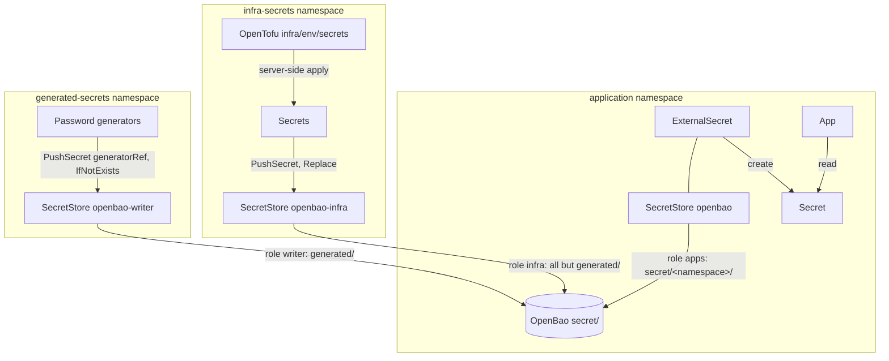

# Secrets management

## Overview

- [OpenBao](https://openbao.org) (`platform/openbao`) holds the cluster's secrets in its KV store `secret/`.
- Every namespace reads its own branch, `secret/<namespace>/<name>`, through its `SecretStore` `openbao`
  (`system/secret-store`, rendered by every Application) and [External Secrets](https://external-secrets.io)
  `ExternalSecret`s. OpenBao refuses a read of another namespace's branch.
- Values come from three places:
  - generated secrets: `platform/generated-secrets` pushes each one to its readers' branches, under
    `secret/<namespace>/generated/`, the only paths its role `writer` reaches;
  - OpenTofu's secrets (Cloudflare's tokens and Tunnel credentials, WireGuard's key): the unit `infra/<env>/secrets`
    writes them as Secrets into namespace `infra-secrets`, and `platform/infra-secrets` pushes them anywhere except
    `generated/` (role `infra`);
  - Kanidm's OAuth2 client secrets: the kaniop operator, directly in each client's namespace.



## Reading a secret

```yaml
apiVersion: external-secrets.io/v1
kind: ExternalSecret
metadata:
  name: grafana-admin
spec:
  secretStoreRef:
    kind: SecretStore
    name: openbao
  data:
    - secretKey: password
      remoteRef:
        key: grafana/generated/admin  # secret/grafana/generated/admin: the namespace's own branch
        property: password
```

`scripts/check-secret-stores` refuses, before merge, an `ExternalSecret` that reads another store or another
namespace's branch, and a generated secret that nobody reads or that is read but never pushed. A secret two namespaces
need is pushed to both branches (`destinations` in `platform/generated-secrets/values.yaml`).

## Unsealing and configuration

- OpenBao unseals itself (`seal "static"`) with a 32-byte key that the OpenTofu unit `infra/<env>/openbao` creates,
  keeps in its state (`.state/`, readable only by you; Cloudflare R2 with state encryption from step 8c) and writes into
  Secret `openbao/openbao-unseal`. Losing the key loses everything OpenBao holds.
- On first start OpenBao configures itself from `platform/openbao/values.yaml` (`initialize` stanzas):
  - the KV v2 store `secret/` and Kubernetes auth;
  - the policies `apps` (read `secret/<namespace>/`), `writer` (push: `create`, `read`, `update` on
    `secret/<namespace>/generated/` only, because External Secrets reads before it writes; no `delete`), `infra` (the
    same everywhere except `generated/`) and `admin`;
  - their roles: `apps` for every namespace's `default` service account, `writer` for `generated-secrets`', `infra` for
    `infra-secrets/openbao-infra` and `admin` for `openbao/openbao-admin`. They accept only service account tokens issued for audience `openbao` (the
    `SecretStore`s ask for it), so a token sent to OpenBao never works against the API server.
- These stanzas run only on an empty storage: editing them later changes nothing on a running OpenBao. Apply the
  change by hand with the admin role (below), or, in the sandbox, `make dev-clean`.
- No root token and no recovery keys exist.
- OpenBao's data has no backup until step 11.

## Emergency access

No root token exists: log in with the admin role, as service account `openbao/openbao-admin`.

```sh
# Logs the bao CLI in OpenBao's pod in with the admin role for an hour; neither token reaches an argument or your
# shell history
kubectl -n openbao create token openbao-admin --audience=openbao --duration=1h |
  kubectl -n openbao exec -i openbao-0 -c openbao -- \
    sh -c 'bao write -field=token auth/kubernetes/login role=admin jwt=- | bao login -no-print -'
kubectl -n openbao exec -it openbao-0 -c openbao -- sh
# Inside, when you are done
bao token revoke -self && rm ~/.vault-token
```

The OpenBao token stays in `~/.vault-token` in the pod until you revoke it, it expires or the pod restarts.
Anyone who can create tokens for `openbao-admin` or exec into OpenBao's pod (cluster admins) holds every secret.

## Generated secrets

Random secrets (admin passwords and other random app secrets; kaniop generates the OAuth2 client secrets) are listed
in `platform/generated-secrets/values.yaml`. Each one is an external-secrets `Password` generator and a `PushSecret`
that runs it (`selector.generatorRef`) and writes the value to each of its `destinations` in OpenBao (`updatePolicy:
IfNotExists`): every reconcile (hourly, a force-sync, an ESO restart) generates a value and writes it only where none
exists, so an existing value never changes and a missing one (an OpenBao that lost its data, a rotation) is written
within the hour. The destinations of a first push all get the same value. Namespace `generated-secrets` holds no
Secret: OpenBao's value is the only one. (Until step 8e a Secret in `global-secrets` held a copy: ESO's
`refreshPolicy: CreatedOnce` regenerates under a stale cache, so the copy could differ from what every app reads.)

```yaml title="./platform/generated-secrets/values.yaml"
--8<--
./platform/generated-secrets/values.yaml
--8<--
```

### Reading a generated value

Read it where the apps read it, in OpenBao, with the admin role (the token never reaches your shell):

```sh
kubectl -n openbao create token openbao-admin --audience=openbao --duration=10m |
  kubectl -n openbao exec -i openbao-0 -c openbao -- \
    sh -c 'export BAO_TOKEN=$(bao write -field=token auth/kubernetes/login role=admin jwt=-); bao kv get -field=<property> secret/<namespace>/generated/<name>; bao token revoke -self >/dev/null'
```

For example `-field=password secret/ntfy/generated/phone-password`. Or read the Secret the app's own ExternalSecret
writes in its namespace.

### Adding a destination

A destination added to an existing entry would get a new value (the push writes a missing destination with what it
generates). Copy the existing value there first, inside OpenBao's pod so it never reaches your terminal, and mark the
copy as External Secrets' (it refuses to write a path without that mark later); then add the destination to
`values.yaml`: the push finds it and leaves it. For `ntfy.alerts-token` gaining `<namespace>/generated/ntfy`:

```sh
kubectl -n openbao create token openbao-admin --audience=openbao --duration=10m |
  kubectl -n openbao exec -i openbao-0 -c openbao -- \
    sh -c 'export BAO_TOKEN=$(bao write -field=token auth/kubernetes/login role=admin jwt=-) &&
      bao kv get -field=token secret/ntfy/generated/alerts-token | bao kv put secret/<namespace>/generated/ntfy token=- &&
      bao kv metadata put -custom-metadata=managed-by=external-secrets secret/<namespace>/generated/ntfy;
      bao token revoke -self >/dev/null'
```

### Rotating

They are never rotated automatically: both sides of a client secret would have to restart together, and admin
passwords are stored in the app's database on first start (roadmap step 11b automates what can be). To rotate one
by hand:

1. Delete every destination of the entry **in one command**, so no push runs between the deletions (a push between
   them would write a value to the first and, later, a different one to the second). For `ntfy.alerts-token`:

    ```sh
    kubectl -n openbao create token openbao-admin --audience=openbao --duration=10m |
      kubectl -n openbao exec -i openbao-0 -c openbao -- \
        sh -c 'export BAO_TOKEN=$(bao write -field=token auth/kubernetes/login role=admin jwt=-) &&
          bao kv metadata delete secret/ntfy/generated/alerts-token &&
          bao kv metadata delete secret/monitoring-system/generated/ntfy; bao token revoke -self >/dev/null'
    ```

2. `kubectl -n generated-secrets annotate pushsecret <name> force-sync=$(date +%s) --overwrite` pushes it at once
   (otherwise within an hour). For an entry with several destinations, check that they hold the same value
   afterwards (compare `bao kv get -field=<key> ... | sha256sum` of each, never the values on screen).
3. Refresh the ExternalSecrets that read it in each destination's namespace, which otherwise keep the old value for
   up to an hour (for example `kubectl -n zot annotate externalsecret zot-auth force-sync=$(date +%s) --overwrite`),
   then restart every app that uses it (for example `kubectl -n zot rollout restart statefulset/zot`).
4. For an admin password, also change it inside the app to the new value.

Kanidm OAuth2 client secrets are generated by the kaniop operator instead, as `<client>-kanidm-oauth2-credentials` in the client's namespace.

## Forgejo's deploy tokens

`lab infra forgejo sync` writes two records with the admin role: `secret/forgejo/deploy` (user `deploy`'s token,
which `lab infra forgejo push` uses) and `secret/argocd/forgejo` (user `argocd`'s read-only token, which the
ExternalSecret `argocd/argocd-repo-forgejo` reads). Running `sync` again keeps a token Forgejo still accepts and
replaces one it does not (for example after Forgejo's data was lost), then refreshes Argo CD's credential.

## Secrets from OpenTofu

The unit `infra/<env>/secrets` (`infra/_modules/secrets`) writes one Secret per OpenBao path into namespace
`infra-secrets` (`<namespace>.<name>`, one key per property) on every `make infra env=…` (the sandbox's in `make dev`).
`platform/infra-secrets` pushes each entry of its `values.yaml` to `secret/<namespace>/<name>` with
`updatePolicy: Replace`: OpenTofu is the source, a changed value replaces OpenBao's within an hour, a lost one comes
back.

| OpenBao path | Source |
|---|---|
| `cert-manager/cloudflare`, `external-dns/cloudflare`, `cloudflared/cloudflare` | `infra/production/cloudflare`'s output `secrets` (production) |
| `wireguard/private-key` | generated by the unit (`wireguard_asymmetric_key`); peers need `terragrunt output wireguard_public_key` in `infra/<env>/secrets` |

Tailscale's auth key (`tailscale/auth-key`) comes from Headscale in step 13. OpenTofu's Cloudflare login (`cf auth login`)
never reaches the cluster.

- Adding one: produce it in OpenTofu (an input of the unit, or a resource in the module), add its path and properties
  to `platform/infra-secrets/values.yaml` (and `values-dev.yaml` if the sandbox has it), and read it from its namespace.
  `scripts/check-secret-stores` refuses a push nobody reads.
- Rotating one: change it in OpenTofu (for a Cloudflare token, `terragrunt apply -replace=cloudflare_account_token.cert_manager`
  in `infra/production/cloudflare`), run `make infra env=production`, then
  `kubectl -n infra-secrets annotate pushsecret <namespace>.<name> force-sync=$(date +%s) --overwrite` or wait an hour,
  and restart the consumer.
- Removing one: delete its entry, then its OpenBao value with the admin role (`bao kv metadata delete …`).

Please see the official documentation for more information:

- [OpenBao](https://openbao.org/docs/)
- [External Secrets Operator](https://external-secrets.io) and its [Vault provider](https://external-secrets.io/latest/provider/hashicorp-vault/)
