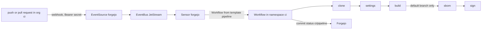

# In-cluster CI: Argo Workflows and Argo Events

Repositories in Forgejo's org `ci` build their images in the cluster: a push runs the golden path, a template in this
repository (`platform/ci/templates/pipeline.yaml`), never a pipeline the repository writes. This repository itself
is not one of them: its CI is GitHub Actions ([CI](ci.md)), and `ops/homelab` only receives deploys
([Deploy to Forgejo](deploy-to-forgejo.md)). The design and its reasons:
`docs/superpowers/specs/2026-11-13-argo-ci-design.md`.

## How a push becomes an image



- `lab infra forgejo sync` keeps org `ci`'s webhook (push and pull request events) pointing at the EventSource, with
  `Authorization: Bearer` and the secret at `secret/ci/generated/webhook`; the EventSource refuses anything else, and
  only Forgejo's pods may reach it (namespace `ci`'s `allow`).
- The Sensor starts the template `pipeline` on a push to a branch (not its deletion) and on a pull request opened,
  updated or reopened. Tags and other events start nothing.
- Each run has its own volume, deleted with it. Steps: clone the commit as `ci-bot`, read `.ci.yaml`, build with
  Buildah; on a push to the default branch also push `registry.<domain>/<image>:<commit>` to zot, make an SPDX SBOM,
  sign the image and attest the SBOM and an SLSA provenance with OpenBao's transit key `ci-signing` (role
  `ci-signer`; the key never leaves OpenBao). Pull requests and other branches build only.
- The commit status `ci/pipeline` goes `pending`, then `success`, `failure` or `error`, linking the run's page.
- Workflows stay a week; pods of steps that passed go at once, failed ones stay with their Workflow. Logs also reach
  Loki, like every pod's.

## Bring a repository

1. Create it in Forgejo's org `ci` (or a pull mirror of a GitHub repository, owner `ci`). Org `ci`'s webhook covers
   every repository: nothing to enable.
2. Give it a `Containerfile` (or `Dockerfile`) at its root. A repository with neither builds nothing (the run passes).
3. Optionally, `.ci.yaml` at its root, with only these keys (anything else fails the run):

    ```yaml
    context: web                       # the build context, inside the repository (default: .)
    containerfile: web/Containerfile   # default: <context>/Containerfile, else <context>/Dockerfile
    image: site                        # zot repository name, [a-z0-9][a-z0-9._-]* (default: the repository's name)
    ```

Builds run with Buildah in their own user namespace under the seccomp profile `homelab/buildah.json`
(`infra/_modules/metal/flake/seccomp`), unprivileged; `vfs` storage, so no layer cache between runs.

## Who signs in

`https://ci.<domain>` (LAN only) signs people in with Kanidm:

| Kanidm group      | In Argo's UI                                          |
|-------------------|-------------------------------------------------------|
| `homelab-admins`  | everything in namespace `ci`, the templates included  |
| `homelab-editors` | runs, resubmits and reads Workflows and their logs    |
| `homelab-users`   | reads Workflows and templates                         |
| anyone else       | refused by Kanidm                                     |

Forgejo's Kanidm login source also makes `homelab-admins` the owners of org `ci` and `homelab-editors` its team
`developers` (create and push repositories). Whatever the UI or the API is asked, the controller runs only Workflows
that reference the golden path's templates (`templateReferencing: Strict`).

## Verify an image

The public key is the ConfigMap `ci/ci-signing-public-key`, copied from OpenBao after every sync of `platform/ci`.
Kyverno's `verify-ci-images` (Audit until step 15b-2) checks every pod's `registry.<domain>/*` image with it:

```sh
kubectl -n ci get configmap ci-signing-public-key -o jsonpath='{.data.cosign\.pub}' > cosign.pub
cosign verify --key cosign.pub --insecure-ignore-tlog=true registry.<domain>/<image>@<digest>
cosign verify-attestation --key cosign.pub --insecure-ignore-tlog=true --type slsaprovenance1 registry.<domain>/<image>@<digest>
cosign verify-attestation --key cosign.pub --insecure-ignore-tlog=true --type spdxjson registry.<domain>/<image>@<digest>
```

No signature goes to a public transparency log: the registry and its image names are the homelab's.

## Secrets

All in OpenBao and the rotation catalog ([Secrets rotation](secrets-rotation.md)):

| Secret | Path | Rotation |
|--------|------|----------|
| the webhook's secret | `ci/generated/webhook` | `ci.webhook`, manual: a new value, `lab infra forgejo sync`, the EventSource restarted |
| `ci-bot`'s Forgejo token | `ci/forgejo-token` | `forgejo.ci-bot-token`, with overlap, from the workstation |
| zot's `ci` password | `zot/generated/ci`, `ci/generated/registry` | `registry.ci`, once no step runs |
| Kanidm client `argo-workflows` | kaniop's Secret | `kanidm-client.argo-workflows` |
| the signing key | OpenBao transit `ci-signing` | `ci.signing-key`, manual (Kyverno needs the new public key) |
