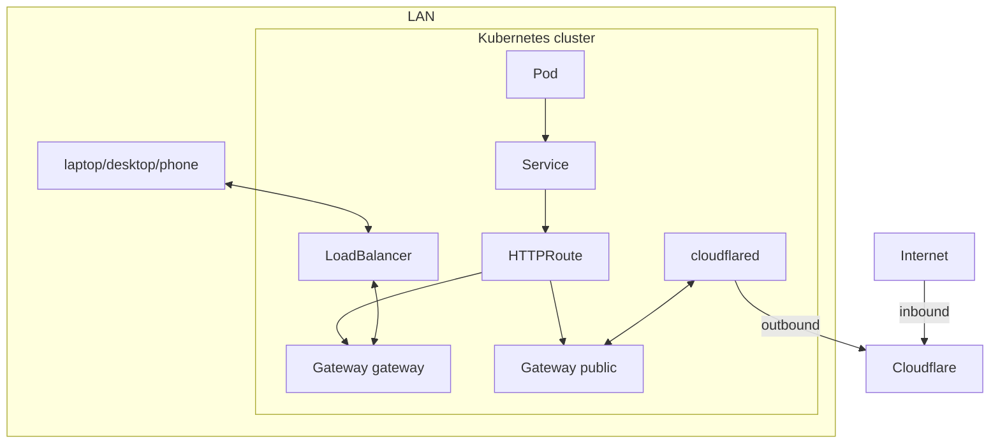

# Networking

The cluster uses k3s's own networking: Flannel, kube-proxy, the network policy controller and ServiceLB. Istio serves two Gateway API `Gateway`s in namespace `istio-system` (`system/istio-system`):

- `gateway` is for the LAN. In production kube-vip gives its LoadBalancer Service its own address (`192.168.1.224`, announced with ARP and moved to another node when one fails); external-dns points each route's hostname at it. It also redirects HTTP to HTTPS and carries Forgejo SSH (port 22, `TCPRoute`), which the nodes' own SSH would block on their addresses. In the sandbox, ServiceLB serves it on the k3d node.
- `public` is published through the Cloudflare Tunnel: its Service is `ClusterIP`, cloudflared forwards to it in the cluster, and external-dns points its routes' hostnames at the tunnel. Only apps that attach to it are reachable from the internet.

kube-vip also holds the Kubernetes API address (`192.168.1.100`) and serves only LoadBalancer Services of class `kube-vip.io/kube-vip-class`; ServiceLB serves the others.

Both terminate TLS with one wildcard certificate. Apps attach an `HTTPRoute` to one of them; there are no `Ingress` objects.

## Service mesh

Every namespace Argo CD manages joins Istio's ambient mesh (`istio.io/dataplane-mode: ambient`, set through Argo CD's `managedNamespaceMetadata`): istio-cni redirects each pod's traffic to the ztunnel on its node, which wraps it in mutual TLS with the workload's SPIFFE identity. A mesh-wide `PeerAuthentication` (`STRICT`) makes meshed pods refuse plaintext. There are no sidecars; apps need no changes.

Outside the mesh:

- `istio-system` (the mesh itself) and `rook-ceph` (host-network pods, Ceph's own encryption), labelled `none` by the `root` ApplicationSet's `templatePatch`
- `kube-system`, which Argo CD does not manage
- the pods the Kubernetes API server calls as webhooks (cert-manager, trust-manager, External Secrets, the Prometheus operator, CloudNativePG), labelled `none` on the pod; `scripts/check-mesh-exclusions` fails if a chart adds a webhook that is still meshed
- the VPN routers (WireGuard, Tailscale), labelled `none` on the pod: ambient would hand the clients' forwarded TCP to ztunnel, which refuses it

The CloudNativePG operator, outside the mesh, polls its PostgreSQL instances' status port (8000); a `PeerAuthentication` on `forgejo-db` lets that port accept plaintext.

The Istio Gateways reach meshed pods over HBONE, so inbound traffic is unchanged. If ztunnel is down on a node, meshed pods there cannot open connections.
