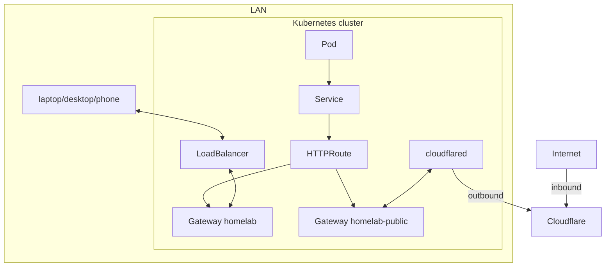

# Networking

Cilium serves two Gateway API `Gateway`s in namespace `gateway` (`system/gateway`):

- `homelab` is for the LAN. Its LoadBalancer IP comes from Cilium LB IPAM and is announced with L2 announcements; external-dns points each route's hostname at it. It also redirects HTTP to HTTPS and carries Forgejo SSH (port 22, `TCPRoute`).
- `homelab-public` is published through the Cloudflare Tunnel: cloudflared forwards to it, and external-dns points its routes' hostnames at the tunnel. Only apps that attach to it are reachable from the internet.

Both terminate TLS with one wildcard certificate. Apps attach an `HTTPRoute` to one of them; there are no `Ingress` objects.
