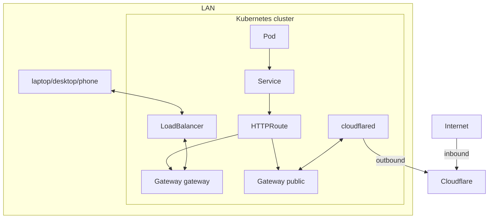

# Networking

The cluster uses k3s's own networking: Flannel, kube-proxy, the network policy controller and ServiceLB. Istio serves two Gateway API `Gateway`s in namespace `istio-system` (`system/istio-system`):

- `gateway` is for the LAN. In production kube-vip gives its LoadBalancer Service its own address (`192.168.1.224`, announced with ARP and moved to another node when one fails); external-dns points each route's hostname at it. It also redirects HTTP to HTTPS and carries Forgejo SSH (port 22, `TCPRoute`), which the nodes' own SSH would block on their addresses. In the sandbox, ServiceLB serves it on the k3d node.
- `public` is published through the Cloudflare Tunnel: its Service is `ClusterIP`, cloudflared forwards to it in the cluster, and external-dns points its routes' hostnames at the tunnel. Only apps that attach to it are reachable from the internet.

kube-vip also holds the Kubernetes API address (`192.168.1.100`) and serves only LoadBalancer Services of class `kube-vip.io/kube-vip-class`; ServiceLB serves the others.

Both terminate TLS with one wildcard certificate. Apps attach an `HTTPRoute` to one of them; there are no `Ingress` objects.
