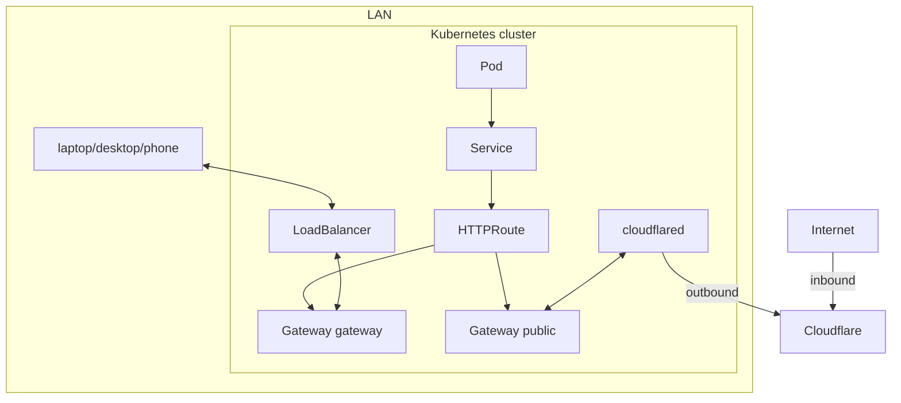

# Networking

The cluster uses k3s's own networking: Flannel, kube-proxy and the network policy controller (and ServiceLB in the sandbox; on the nodes it would overwrite kube-vip's addresses, so it is off). Istio serves two Gateway API `Gateway`s in namespace `istio-system` (`system/istio-system`):

- `gateway` is for the LAN. In production kube-vip gives its LoadBalancer Service its own address (`192.168.0.2`, announced with ARP and moved to another node when one fails); external-dns points each route's hostname at it. It also redirects HTTP to HTTPS and carries Forgejo SSH (port 22, `TCPRoute`), which the nodes' own SSH would block on their addresses. In the sandbox, ServiceLB serves it on the k3d node.
- `public` is published through the Cloudflare Tunnel: its Service is `ClusterIP`, cloudflared forwards to it in the cluster, and external-dns points its routes' hostnames at the tunnel. Only apps that attach to it are reachable from the internet.

kube-vip also holds the Kubernetes API address (`192.168.0.10`) and serves LoadBalancer Services of class `kube-vip.io/kube-vip-class`, the only LoadBalancer Services the nodes have.

These addresses are set in `infra/<env>/cluster/config.json` (upstream's format: `vip`, `network`, plus `service_vips`); Argo CD passes them to every chart as `global.addresses.*`, and `scripts/check-env-config` keeps addresses out of charts and app files.

Both terminate TLS with one wildcard certificate. Apps attach an `HTTPRoute` to one of them; there are no `Ingress` objects.

## Service mesh

Every namespace Argo CD manages joins Istio's ambient mesh (`istio.io/dataplane-mode: ambient`, set through Argo CD's `managedNamespaceMetadata`): istio-cni redirects each pod's traffic to the ztunnel on its node, which wraps it in mutual TLS with the workload's SPIFFE identity. A mesh-wide `PeerAuthentication` (`STRICT`) makes meshed pods refuse plaintext. There are no sidecars; apps need no changes.

Outside the mesh:

- `istio-system` (the mesh itself) and `rook-ceph` (some host-network pods, Ceph's own encryption), labelled `none` by the `root` ApplicationSet's `templatePatch`
- `kube-system`, which Argo CD does not manage
- the pods the Kubernetes API server calls as webhooks (cert-manager, trust-manager, External Secrets, the Prometheus operator, CloudNativePG), labelled `none` on the pod; `scripts/check-mesh-policies` fails if a chart adds a webhook that is still meshed
- the VPN routers (WireGuard, Tailscale), labelled `none` on the pod: ambient would hand the clients' forwarded TCP to ztunnel, which refuses it

The CloudNativePG operator, outside the mesh, polls its PostgreSQL instances' status port (8000); a `PeerAuthentication` on `forgejo-db` lets that port accept plaintext.

The Istio Gateways reach meshed pods over HBONE, so inbound traffic is unchanged. Meshed connections arrive on ztunnel's HBONE port (TCP 15008), so a chart that ships NetworkPolicies (Argo CD) also gets a policy `allow-hbone` that lets that port in. If ztunnel is down on a node, meshed pods there cannot open connections.

Inside the mesh nothing is reachable unless allowed: `deny-all` in `istio-system` (the Gateways keep `allow-gateways`) and one `AuthorizationPolicy` `allow` per namespace, in the namespace's chart or app file: pods of the same namespace, the Gateway its routes attach to (on the pod ports behind them), Prometheus on the metrics ports, and a few named callers (Grafana to Prometheus and Loki, Argo CD's repo server to Forgejo, CloudNativePG's operator to its instances). Pods outside the mesh get a NetworkPolicy that opens only their webhook, VPN or metrics ports. A new app needs its `allow` policy; `scripts/check-mesh-policies` fails without it. Outbound traffic is restricted too (see Egress).

### Node restarts

When a node restarts, the kubelet recreates its pods while the node's ztunnel may still be waiting for istiod. istio-cni cannot hand those pods to ztunnel within its 5-second limit, containerd tears their sandboxes down, and istio-cni's snapshot keeps their dead network namespaces, which ztunnel then retries forever: the node's meshed pods stay `Pending` and ztunnel stays not Ready. istio-cni works through those pods one at a time, and while each takes more than 5 seconds none ever succeeds. Two settings get the node out: istio-cni skips IPv6 rules (`cni.ambient.ipv6: false`; pods only get IPv4), which halves its work per pod, and the CronJob `istio-system/istio-cni-watchdog` clears a stuck node: one whose ztunnel has run for 3 minutes without becoming Ready, or where a pod has had no sandbox for 3 minutes while istio-cni's add keeps failing for it (its `FailedCreatePodSandBox` events; ztunnel can report Ready while it still retries dead network namespaces). It deletes the node's istio-cni pod, so the new istio-cni builds its snapshot again, or both istio-cni and ztunnel when istio-cni was already restarted after ztunnel's start and the node is still stuck (the sandbox's power cuts cleared only once both were new); it waits 3 minutes after either restart. The sandbox recovers in 5 to 14 minutes. Look at `kubectl -n istio-system get pods` and the watchdog Jobs' logs. istio-cni writes its own CNI config file (`istioOwnedCNIConfig`), because k3s rewrites `10-flannel.conflist` at every start.

## Egress

Every namespace Argo CD manages (except `istio-system` and `rook-ceph`) gets `system/egress`: egress is denied except to the cluster (pod and Service ranges: DNS, the Gateway, pods outside the mesh), the Kubernetes API (the node network, port 6443) and the LAN Gateway's VIP. Namespaces listed in `system/egress/values.yaml` also reach the internet (any address except the private ranges) on their ports, and `monitoring-system` the nodes' metrics ports. Nothing reaches the rest of the LAN. Traffic between meshed pods and in-cluster DNS go through ztunnel and are governed by the mesh's AuthorizationPolicies, not by these policies. k3s's network policy controller applies policies to a new pod asynchronously, so a pod's first seconds are not yet restricted.

ESO's controller reads every namespace's Secrets, so it never reaches the internet: anything that needs a token from
outside mints it in its own namespace (Renovate's GitHub token, in Renovate's pod; `docs/how-to-guides/renovate.md`).

## What crosses the LAN

The nodes carry pod traffic between them with flannel's `wireguard-native` backend (G12,
`docs/superpowers/specs/2026-11-26-lan-encryption-design.md`): each node has interface `flannel-wg` (UDP 51820, MTU
1420) with a peer for every other node, keyed by the public key in that node's annotation
`flannel.alpha.coreos.com/backend-data`. The private key is flannel's own, in `/run/flannel/wgkey`: a new one at every
boot, never in git or OpenBao. A node started before another keeps a peer for that node's previous key, with no allowed
IPs: it routes nothing. The firewall takes 51820 only from the nodes' addresses. The sandbox keeps k3s's VXLAN: it has
one node.

What crossed the testbed's uplinks during `just testbed` (`scripts/lan-flows testbed 1800`, each node's uplink:
WireGuard on 2026-11-26, VXLAN again on 2026-11-27, the same flows but UDP 8472 in place of 51820):

| Flow | Port | Protected by | |
|---|---|---|---|
| Pod to pod on another node: Ceph's OSDs and the RBD client (Ceph is on the pod network), the mesh's HBONE, pods to CoreDNS, CloudNativePG's operator | UDP 51820 | WireGuard (and mTLS inside it for the mesh) | was UDP 8472 in clear with VXLAN |
| etcd between the servers, clients to etcd | TCP 2380, 2379 | TLS (etcd's peer and client certificates) | |
| The API server (kubelets, pods through Service `kubernetes`, the VIP `.10`) | TCP 6443 | TLS | |
| The API server to the kubelets | TCP 10250 | TLS | |
| DNS from the nodes to their resolvers | UDP 53 | none | accepted until LAN DNS (DoH/DoT upstream) |
| NTP | UDP 123 | none | accepted: public time, nothing secret |
| ICMP to the resolvers, ARP | | none | carries nothing |
| Pulls and other calls to the internet | TCP 443 | TLS | |
| The VMs' metadata address `169.254.169.254` | TCP 80 | none | the testbed's VMs only (libvirt's NAT network); not in production's capture (10 minutes, 2026-11-26) |

Not seen on the testbed, which runs no monitoring, but on the host network in production: Prometheus scraping the nodes'
metrics (node-exporter 9100, kube-proxy 10249, etcd 2381) over plain HTTP. Accepted: they carry no secrets, and TLS
would need a proxy in front of each exporter. One packet left a node's uplink for a Service address (`10.43.x`) on
Ceph's monitor port 3300, once in 30 minutes: from the host network (ceph-csi's RBD plugin runs there), untranslated by
kube-proxy; nothing else of that connection crossed in clear, and production's capture checks for it once 12b-2 runs
Ceph there.
