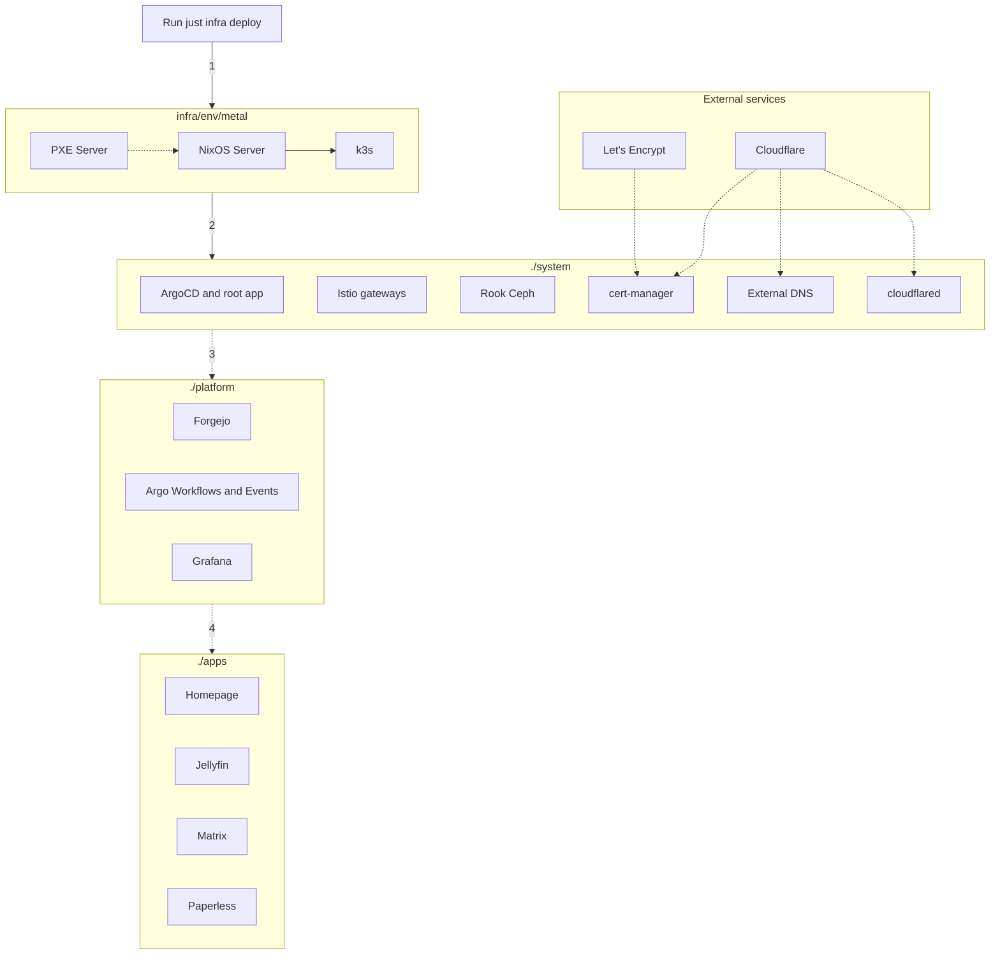

# Overview

## Components

```
+--------------+
|    ./apps    |
|--------------|
|  ./platform  |
|--------------|       +------------+
|   ./system   |- - - -| ./external |
|--------------|       +------------+
|   ./infra    |
|--------------|
|   HARDWARE   |
+--------------+
```

Main components:

- `./infra`: OpenTofu and Terragrunt: the nodes (`infra/<env>/metal`: NixOS and k3s), the sandbox's cluster, Argo CD's
  bootstrap and the cloud resources
- `./system`: critical system components for the cluster (load balancer, storage, Gateway API gateways, operation tools...)
- `./platform`: essential components for service hosting platform (git, build runners, dashboards...)
- `./apps`: user facing applications
- `./external` (optional): externally managed services

Support components:

- `./docs`: all documentation go here, this will generate a searchable web UI
- `./scripts`: scripts to automate common tasks

## Provisioning flow

Everything is automated, after you edit the configuration files, you just need to run a single `just infra deploy production` command and it will:

- (1) Apply the `metal` unit (`infra/<env>/metal`):
    - Create an ephemeral, stateless PXE server (`nixie`)
    - Install NixOS on all servers in parallel
    - Build a Kubernetes cluster (based on k3s) and export its kubeconfig
- (2) Bootstrap the `./system` layer:
    - Install Argo CD and its ApplicationSets with OpenTofu (`infra/<env>/argocd`, applied again whenever `system/argocd`
      changes); Argo CD syncs every other layer from git
    - Install the remaining components (storage, monitoring, etc)
- (3) Build the `./platform` layer (Forgejo, Grafana, SSO, etc)
- (4) Deploy applications in the `./apps` layer



Logs: Alloy on every node reads the pods' logs and the cluster's events into Loki (`system/loki`), which Grafana queries
([logs](../../how-to-guides/logs.md)).
