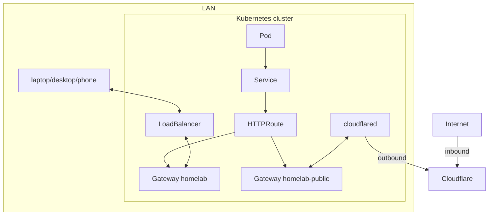

# Gateway API (sub-project 2) Implementation Plan

> **For agentic workers:** REQUIRED SUB-SKILL: Use superpowers:subagent-driven-development (recommended) or superpowers:executing-plans to implement this plan task-by-task. Steps use checkbox (`- [ ]`) syntax for tracking.

**Goal:** Replace ingress-nginx and every `Ingress` with two Cilium Gateway API `Gateway`s (`homelab` for the LAN, `homelab-public` for the Cloudflare Tunnel) sharing one wildcard certificate, and prove it in the sandbox with five more apps.

**Architecture:**
- **Gateways.** `metal/` installs the Gateway API CRDs before Cilium and enables Cilium's Gateway controller. A new ArgoCD component `system/gateway` holds both Gateways, the wildcard `Certificate` and an HTTP→HTTPS redirect route.
- **Routes.** Every app attaches an `HTTPRoute` (gitea also a `TCPRoute`) to one Gateway, mostly through its chart's own route support after upgrading the chart to its latest version.
- **Sandbox CA.** trust-manager copies the dev CA into a ConfigMap `homelab-dev-ca` in every namespace. It replaces the ingress certificate secrets that Go apps used for `ca.crt`, and it is the CA for Kanidm's `BackendTLSPolicy`.

**Tech Stack:** Cilium 1.20.2, Gateway API CRDs v1.6.3 (standard channel), cert-manager v1.21.2, trust-manager v0.25.0, Helm wrapper charts synced by ArgoCD, Ansible (`metal/`), Go tests with terratest and chromedp.

**Spec:** `docs/superpowers/specs/2026-10-13-gateway-api-design.md`

## Global Constraints

- **Workflow:**
  - Work on branch `feat/gateway-api` (already created from `dev`; the spec is committed there). One concern per commit.
  - Commits end with:
    ```
    Co-Authored-By: Claude Opus 5.5 <noreply@anthropic.com>
    Claude-Session: https://claude.ai/code/session_01GZDRNK1oUcGXXSC3R6dhN2
    ```
  - Run everything inside the dev shell (`nix develop`, or direnv). `Chart.lock` and `charts/` are gitignored.
  - Before the merge, only basic checks run; the sandbox is touched after the PR is merged into `dev` (Tasks 14–15). Do not run `make dev` or `make -C metal` before that.
- **Versions** (verified 2026-10-13, pin exactly): Gateway API `v1.6.3`; Cilium `1.20.2` (unchanged); trust-manager `v0.25.0`; argo-cd `10.10.3` (unchanged); dex `0.26.0` (unchanged); grafana `13.5.1`; zot `0.1.128` (unchanged); kaniop `0.19.0`; app-template `5.3.0`; gitea `12.7.0`; woodpecker `3.7.5`; elementweb `0.0.6` (unchanged); dendrite `0.14.6`; external-dns `1.23.0`; cert-manager `v1.21.2` (unchanged).
- **Gateways** (namespace `gateway`):
  - `homelab`: listeners `http` (80, routes from namespace `gateway` only), `https` (443, hostname `*.<domain>`, routes from all namespaces), `ssh` (22, TCP, `TCPRoute`s from namespace `gitea` only). Sandbox address `172.30.255.200`.
  - `homelab-public`: listener `https` only; annotation `external-dns.kubernetes.io/target: homelab-tunnel.<domain>`; address from the pool.
  - Wildcard secret `homelab-wildcard-tls` (Certificate `homelab-wildcard`, issuer `letsencrypt-prod`).
  - Services created by Cilium: `cilium-gateway-homelab`, `cilium-gateway-homelab-public`.
- **parentRefs:** `{name: homelab, namespace: gateway, sectionName: https}`, or `homelab-public` for excalidraw, blog and matrix's Element. In the sandbox, excalidraw uses `homelab`.
- **Annotations:** external-dns prefix `external-dns.kubernetes.io/` (never `external-dns.alpha.`). Public routes carry `external-dns.kubernetes.io/cloudflare-proxied: "true"`; the target is set only on `homelab-public`.
- **Dev CA:** ConfigMap `homelab-dev-ca`, key `ca.crt`, in every namespace; mounts use `optional: true`. Paths stay `/etc/homelab-dev-ca/ca.crt` (Dex: `/etc/dex/dev-ca/ca.crt`).
- **Helm values:** Helm replaces lists and cannot delete keys across values files; dev overrides restate whole lists. Use `""` (not `null`) to blank an annotation in `values-dev.yaml`.
- **Gateway API kinds render as `gateway.networking.k8s.io/v1`.** Charts choose the API version from `.Capabilities`; `scripts/render-chart` passes the same API versions ArgoCD sees (Task 1).
- **Hosts (sandbox):** `<app>.127-0-0-1.nip.io`; prod keeps `khuedoan.com` until sub-project 3.
- **Offline unit tests:** `cd test && go vet ./... && go test -run 'TestSmokeAppsForEnv|TestIdentity(HasGroup|TOTPWaitsForNextStep)|TestGatewayRouteReady' ./...`.

## Review Focus

1. **Running sandbox upgrade:** the ApplicationSet does not delete an Application's resources, so the old ingress-nginx Service keeps holding `172.30.255.200` and the `homelab` Gateway gets no address. → Task 15 deletes ingress-nginx's leftovers before `make dev`, and `TestGatewayProgrammed` asserts the address.
2. **Cilium on an existing cluster:** its operator enables the Gateway controller only if the CRDs exist when it starts, and a Helm values change does not restart it. → Task 3 restarts the operator and agents whenever the Cilium release changes; Task 15 checks GatewayClass `cilium` is `Accepted`.
3. **Renames from major chart upgrades:** app-template 5 renames PVCs (`<app>-data` → `<app>`), ConfigMaps (`homepage-config` → `homepage`) and the main Service of multi-controller apps (`ollama` → `ollama-main`); gitea 12 renders `TCPRoute` `v1alpha2`, which v1.6 CRDs no longer serve. → Tasks 8, 9, 10 and 12 assert the rendered names; Task 10 writes its own `TCPRoute`.
4. **Wrong Gateway means wrong exposure:** a LAN app on `homelab-public` is published on the internet; a public app on `homelab` silently loses its DNS record. → Task 13's pre-PR check lists every route's parent in both environments and compares it with the allowed set.
5. **Large uploads and long requests through Envoy:** nginx had `proxy-body-size: 0` for zot and 50m for speedtest; Envoy differs. → zot's route sets `timeouts.request: 0s`, and `TestGatewayZotLargePush` pushes 200 MiB.

---

## File Structure

| File | Responsibility |
|---|---|
| `scripts/render-chart` | render like ArgoCD, including Gateway API capabilities |
| `metal/roles/cilium/{defaults,tasks}/main.yml` | Gateway API CRDs, `gatewayAPI.enabled`, restart after a change |
| `metal/roles/coredns_rewrite/tasks/main.yml`, `metal/inventories/dev.yml` | replace the `*.127-0-0-1.nip.io` rewrite; target the Gateway Service |
| `metal/Makefile` | socat target variable renamed to `gateway_ip` |
| `system/cert-manager/{Chart.yaml,values.yaml,values-dev.yaml,templates/bundle.yaml}` | trust-manager and the dev CA Bundle (sandbox) |
| `system/gateway/` (new) | Gateways, wildcard Certificate, HTTPS redirect |
| `system/ingress-nginx/` | deleted |
| `system/argocd/values.yaml`, `values-dev.yaml` | argocd route, dev CA mount, sandbox allowlist |
| `platform/dex`, `platform/grafana`, `platform/zot` | routes, dev CA mounts, grafana 13.5.1 |
| `platform/kanidm/{Chart.yaml,values.yaml,values-dev.yaml,templates/kanidm.yaml,templates/certificate.yaml}` | kaniop 0.19 route, BackendTLSPolicy, Kanidm certificate |
| `apps/{excalidraw,actualbudget,homepage,pairdrop,speedtest,blog,jellyfin,ollama,paperless}` | app-template 5.3.0 routes |
| `platform/gitea/{Chart.yaml,values.yaml,values-dev.yaml,templates/tcproute.yaml,templates/config-*.yaml}` | gitea 12.7.0, routes, sandbox SQLite |
| `platform/woodpecker`, `apps/matrix` | chart upgrades, own `templates/httproute.yaml` |
| `system/cloudflared`, `system/external-dns` | public Gateway, `gateway-httproute` source |
| `test/gateway_helpers_test.go` (new) | `condition`, `conditionsMet`, `httpRoute.ready`, `getResource`, `routeHost` |
| `test/gateway_test.go` (new) | `TestGatewayRouteReady` (offline) and the sandbox Gateway tests |
| `test/smoke_test.go`, `test/apps_test.go`, `test/integration_test.go`, `Makefile` | smoke via HTTPRoutes, 11 sandbox apps, `Gateway` filter |
| `scripts/get-status`, `scripts/get-dns-config` | HTTPRoutes instead of Ingresses |
| `docs/**`, `README.md`, `CLAUDE.md` | Gateway docs and production checklist |

---

### Task 1: Render charts with the Gateway API capabilities

**Files:**
- Modify: `scripts/render-chart`

**Interfaces:**
- Produces: `scripts/render-chart <dir> [env]` renders Gateway API kinds as `gateway.networking.k8s.io/v1`, as ArgoCD does once the CRDs exist.

- [ ] **Step 1: Show the problem.** `apps/excalidraw` will use app-template's route, which picks its API version from `.Capabilities`. A quick throwaway render shows the fallback:

```bash
tmp=$(mktemp -d) && cp -r apps/excalidraw "$tmp/" && rm -rf "$tmp/excalidraw/charts"
yq -i 'del(.app-template.ingress) | .app-template.route.main.hostnames = ["x.example"] | .app-template.route.main.parentRefs = [{"name":"homelab","namespace":"gateway"}]' "$tmp/excalidraw/values.yaml"
scripts/render-chart "$tmp/excalidraw" | yq 'select(.kind=="HTTPRoute") | .apiVersion'
```

Expected: `gateway.networking.k8s.io/v1alpha2` (wrong: v1.6 CRDs do not serve it).

- [ ] **Step 2: Pass the API versions.** Replace the last line of `scripts/render-chart`:

```sh
helm template "$name" "$dir" --namespace "$name" --include-crds "$@"
```

with:

```sh
# ArgoCD passes the cluster's API versions; charts pick Gateway API versions from them
set -- "$@" --api-versions gateway.networking.k8s.io/v1
for kind in Gateway HTTPRoute TCPRoute BackendTLSPolicy ReferenceGrant; do
  set -- "$@" --api-versions "gateway.networking.k8s.io/v1/$kind"
done
helm template "$name" "$dir" --namespace "$name" --include-crds "$@"
```

- [ ] **Step 3: Verify.** Rerun the render from Step 1. Expected: `gateway.networking.k8s.io/v1`. Then `rm -rf "$tmp"`.

- [ ] **Step 4: Commit.**

```bash
git add scripts/render-chart
git commit -m "build: render charts with the Gateway API versions ArgoCD sees"
```

---

### Task 2: Tests read HTTPRoutes; Gateway tests

**Files:**
- Create: `test/gateway_helpers_test.go`, `test/gateway_test.go`
- Modify: `test/smoke_test.go`, `test/apps_test.go`, `test/integration_test.go`, `Makefile`

**Interfaces:**
- Consumes: `insecureClient`, `sandboxIngress`, `secretValue`, `waitForApp`, `registryHost` (existing in `test/`).
- Produces:
  - `type condition struct{ Type, Status string }`
  - `func conditionsMet(conditions []condition, types ...string) bool`
  - `type httpRoute struct` with `func (r httpRoute) ready() bool`
  - `func getResource(t *testing.T, namespace string, out any, args ...string) bool`
  - `func routeHost(t *testing.T, namespace, name string) string`
  - Tests `TestGatewayRouteReady` (offline), `TestGatewayProgrammed`, `TestGatewayHTTPSRedirect`, `TestGatewayNoIngress`, `TestGatewayGiteaSSH`, `TestGatewayZotLargePush` (sandbox).

- [ ] **Step 1: Write the failing offline test.** Create `test/gateway_test.go`:

```go
package test

import (
	"bufio"
	"bytes"
	"crypto/sha256"
	"encoding/json"
	"fmt"
	"io"
	"math/rand"
	"net"
	"net/http"
	"os"
	"strings"
	"testing"
	"time"

	"github.com/stretchr/testify/assert"
	"github.com/stretchr/testify/require"
)

func TestGatewayRouteReady(t *testing.T) {
	both := `{"type":"Accepted","status":"True"},{"type":"ResolvedRefs","status":"True"}`
	cases := map[string]struct {
		route string
		want  bool
	}{
		"accepted with resolved backends": {`{"spec":{"hostnames":["a.example"]},"status":{"parents":[{"conditions":[` + both + `]}]}}`, true},
		"not reconciled yet":              {`{"spec":{"hostnames":["a.example"]}}`, false},
		"backend missing":                 {`{"spec":{"hostnames":["a.example"]},"status":{"parents":[{"conditions":[{"type":"Accepted","status":"True"},{"type":"ResolvedRefs","status":"False"}]}]}}`, false},
		"one parent refused":              {`{"spec":{"hostnames":["a.example"]},"status":{"parents":[{"conditions":[` + both + `]},{"conditions":[{"type":"Accepted","status":"False"},{"type":"ResolvedRefs","status":"True"}]}]}}`, false},
		"no hostname":                     {`{"status":{"parents":[{"conditions":[` + both + `]}]}}`, false},
	}
	for name, c := range cases {
		t.Run(name, func(t *testing.T) {
			var r httpRoute
			require.NoError(t, json.Unmarshal([]byte(c.route), &r))
			assert.Equal(t, c.want, r.ready())
		})
	}
}
```

- [ ] **Step 2: Run it to verify it fails.**

Run: `cd test && go test -run TestGatewayRouteReady ./...`
Expected: FAIL to compile: `undefined: httpRoute` (and unused imports).

- [ ] **Step 3: Implement the helpers.** Create `test/gateway_helpers_test.go`:

```go
package test

import (
	"encoding/json"
	"os/exec"
	"testing"
	"time"

	"github.com/stretchr/testify/require"
)

// condition is the part of a Kubernetes status condition the tests read.
type condition struct {
	Type   string `json:"type"`
	Status string `json:"status"`
}

// conditionsMet reports whether every wanted condition type has status True.
func conditionsMet(conditions []condition, types ...string) bool {
	status := map[string]string{}
	for _, c := range conditions {
		status[c.Type] = c.Status
	}
	for _, t := range types {
		if status[t] != "True" {
			return false
		}
	}
	return true
}

// httpRoute is the part of a Gateway API HTTPRoute the tests read.
type httpRoute struct {
	Spec struct {
		Hostnames []string `json:"hostnames"`
	} `json:"spec"`
	Status struct {
		Parents []struct {
			Conditions []condition `json:"conditions"`
		} `json:"parents"`
	} `json:"status"`
}

// ready reports whether the route has a hostname and every parent Gateway accepted it with resolved backends.
func (r httpRoute) ready() bool {
	if len(r.Spec.Hostnames) == 0 || len(r.Status.Parents) == 0 {
		return false
	}
	for _, p := range r.Status.Parents {
		if !conditionsMet(p.Conditions, "Accepted", "ResolvedRefs") {
			return false
		}
	}
	return true
}

// getResource decodes `kubectl get <args> --output json` into out and reports whether the command succeeded.
// It reads stdout only, so kubectl warnings cannot break the JSON.
func getResource(t *testing.T, namespace string, out any, args ...string) bool {
	args = append(append([]string{"--namespace", namespace, "get"}, args...), "--output", "json")
	raw, err := exec.Command("kubectl", args...).Output()
	if err != nil {
		return false
	}
	require.NoError(t, json.Unmarshal(raw, out))
	return true
}

// routeHost waits until the HTTPRoute is ready and returns its first hostname.
func routeHost(t *testing.T, namespace, name string) string {
	var route httpRoute
	require.Eventually(t, func() bool {
		route = httpRoute{}
		return getResource(t, namespace, &route, "httproute", name) && route.ready()
	}, 30*time.Minute, 30*time.Second, "HTTPRoute %s/%s is not accepted with resolved backends", namespace, name)
	return route.Spec.Hostnames[0]
}
```

- [ ] **Step 4: Add the sandbox Gateway tests.** Append to `test/gateway_test.go`:

```go
func gatewaySandboxOnly(t *testing.T) {
	if os.Getenv("ENV") != "dev" {
		t.Skip("Gateway tests run against the sandbox only")
	}
}

// gateway is the part of a Gateway API Gateway the tests read.
type gateway struct {
	Status struct {
		Addresses []struct {
			Value string `json:"value"`
		} `json:"addresses"`
		Conditions []condition `json:"conditions"`
	} `json:"status"`
}

func TestGatewayProgrammed(t *testing.T) {
	gatewaySandboxOnly(t)
	for _, name := range []string{"homelab", "homelab-public"} {
		t.Run(name, func(t *testing.T) {
			var gw gateway
			require.Eventually(t, func() bool {
				gw = gateway{}
				return getResource(t, "gateway", &gw, "gateway", name) && conditionsMet(gw.Status.Conditions, "Accepted", "Programmed")
			}, 20*time.Minute, 15*time.Second, "Gateway %s is not programmed", name)
			if name == "homelab" {
				require.NotEmpty(t, gw.Status.Addresses)
				assert.Equal(t, sandboxIngress, gw.Status.Addresses[0].Value, "the localhost proxy forwards to this address")
			}
		})
	}
}

func TestGatewayHTTPSRedirect(t *testing.T) {
	gatewaySandboxOnly(t)
	host := routeHost(t, "excalidraw", "excalidraw")
	resp, err := insecureClient.Get("http://" + host + "/some/path?x=1")
	require.NoError(t, err)
	resp.Body.Close()
	assert.Equal(t, http.StatusMovedPermanently, resp.StatusCode)
	assert.Equal(t, "https://"+host+"/some/path?x=1", resp.Header.Get("Location"))
}

func TestGatewayNoIngress(t *testing.T) {
	gatewaySandboxOnly(t)
	var ingresses struct {
		Items []any `json:"items"`
	}
	require.True(t, getResource(t, "default", &ingresses, "ingress", "--all-namespaces"))
	assert.Empty(t, ingresses.Items, "every component uses Gateway API routes")
	var namespace struct{}
	assert.False(t, getResource(t, "default", &namespace, "namespace", "ingress-nginx"), "ingress-nginx must be gone")
}

func TestGatewayGiteaSSH(t *testing.T) {
	gatewaySandboxOnly(t)
	require.Eventually(t, func() bool {
		conn, err := net.DialTimeout("tcp", net.JoinHostPort(sandboxIngress, "22"), 10*time.Second)
		if err != nil {
			return false
		}
		defer conn.Close()
		_ = conn.SetReadDeadline(time.Now().Add(10 * time.Second))
		banner, err := bufio.NewReader(conn).ReadString('\n')
		return err == nil && strings.HasPrefix(banner, "SSH-2.0-")
	}, 20*time.Minute, 15*time.Second, "no SSH banner from gitea on %s:22", sandboxIngress)
}

// TestGatewayZotLargePush uploads one 200 MiB blob through the Gateway, as an image push would.
func TestGatewayZotLargePush(t *testing.T) {
	gatewaySandboxOnly(t)
	base := "https://" + registryHost
	waitForApp(t, base+"/livez")
	password := secretValue(t, "global-secrets", "registry.ci", "password")

	// Same content every run, so zot stores a single copy
	blob := make([]byte, 200<<20)
	rand.New(rand.NewSource(1)).Read(blob)
	digest := fmt.Sprintf("sha256:%x", sha256.Sum256(blob))

	client := *insecureClient
	client.Timeout = 5 * time.Minute

	req, err := http.NewRequest("POST", base+"/v2/gateway-test/blobs/uploads/", nil)
	require.NoError(t, err)
	req.SetBasicAuth("ci", password)
	resp, err := client.Do(req)
	require.NoError(t, err)
	resp.Body.Close()
	require.Equal(t, http.StatusAccepted, resp.StatusCode)
	location, err := resp.Location()
	require.NoError(t, err)
	query := location.Query()
	query.Set("digest", digest)
	location.RawQuery = query.Encode()

	req, err = http.NewRequest("PUT", location.String(), bytes.NewReader(blob))
	require.NoError(t, err)
	req.SetBasicAuth("ci", password)
	req.Header.Set("Content-Type", "application/octet-stream")
	start := time.Now()
	resp, err = client.Do(req)
	require.NoError(t, err)
	body, _ := io.ReadAll(resp.Body)
	resp.Body.Close()
	require.Equal(t, http.StatusCreated, resp.StatusCode, "%s", body)
	t.Logf("pushed 200 MiB through the Gateway in %s", time.Since(start).Round(time.Millisecond))
}
```

- [ ] **Step 5: Run the offline tests.**

Run: `cd test && gofmt -l . && go vet ./... && go test -run 'TestGatewayRouteReady' -v ./...`
Expected: no gofmt output, vet clean, 5 subtests PASS. The sandbox tests are not run here (they skip outside `ENV=dev`, and the sandbox has no Gateway yet).

- [ ] **Step 6: Smoke tests read HTTPRoutes.** In `test/smoke_test.go`:
  - Change the comment on `smokeApps` to `// smokeApps returns the apps whose HTTPRoute is checked; the sandbox only runs a subset.`
  - Append to the dev list, after `{"zot", "zot"},`:

```go
			{"actualbudget", "actualbudget"},
			{"homepage", "homepage"},
			{"pairdrop", "pairdrop"},
			{"speedtest", "speedtest"},
			{"gitea", "gitea"},
```

  - Replace the body of the `t.Run` closure in `TestSmoke` with:

```go
			t.Parallel()

			// Wait until the Gateway accepted the route with a resolved backend
			host := routeHost(t, app.namespace, app.name)

			// Setup a TLS configuration, ignore the certificate because we may not use cert-manager (like the sandbox environment)
			tlsConfig := tls.Config{
				InsecureSkipVerify: os.Getenv("INSECURE_SKIP_VERIFY") != "",
			}

			// Test the endpoint, this will only fail if we timeout waiting for the service to return a 200 response
			http_helper.HttpGetWithRetryWithCustomValidation(
				t,
				fmt.Sprintf("https://%s", host),
				&tlsConfig,
				30,
				60*time.Second,
				func(statusCode int, body string) bool {
					return statusCode == 200
				},
			)
```

  - Remove the now unused `k8s` import.

- [ ] **Step 7: Update `TestSmokeAppsForEnv`.** In `test/apps_test.go`, append the same five entries to `dev` after `{"zot", "zot"},`.

- [ ] **Step 8: `TestArgoCDCheck` reads the HTTPRoute.** In `test/integration_test.go`, replace the lines from `options := k8s.NewKubectlOptions(...)` through `ingress := k8s.GetIngress(...)` (with their comments) by:

```go
	// Wait until the Gateway accepted the Argo CD route
	host := routeHost(t, "argocd", "argocd-server")
```

and use `fmt.Sprintf("https://%s", host)` in the HTTP check. Remove the unused `k8s` import.

- [ ] **Step 9: `make dev` runs the Gateway tests.** In the root `Makefile`, change `smoke_filter='Smoke|Identity|SSO'` to `smoke_filter='Smoke|Identity|SSO|Gateway'`.

- [ ] **Step 10: Verify.**

Run: `cd test && gofmt -l . && go vet ./... && go test -run 'TestSmokeAppsForEnv|TestIdentity(HasGroup|TOTPWaitsForNextStep)|TestGatewayRouteReady' ./...`
Expected: `ok`.

- [ ] **Step 11: Commit.**

```bash
git add test Makefile
git commit -m "test: read HTTPRoutes, add Gateway tests and five sandbox smoke apps"
```

---

### Task 3: Gateway API CRDs and Cilium's Gateway controller

**Files:**
- Modify: `metal/roles/cilium/defaults/main.yml`, `metal/roles/cilium/tasks/main.yml`, `metal/roles/coredns_rewrite/tasks/main.yml`, `metal/inventories/dev.yml`, `metal/Makefile`

**Interfaces:**
- Produces: GatewayClass `cilium` (created by Cilium); CoreDNS sends `*.127-0-0-1.nip.io` to `cilium-gateway-homelab.gateway.svc.cluster.local` in the sandbox.

- [ ] **Step 1: Variables.** In `metal/roles/cilium/defaults/main.yml`, after `cilium_namespace: kube-system` add:

```yaml
# Gateway API CRDs (standard channel). Cilium enables its Gateway controller only when they exist at start.
gateway_api_version: v1.6.3
```

and add to `cilium_values` (after `l2announcements`):

```yaml
  gatewayAPI:
    enabled: true
```

- [ ] **Step 2: Install the CRDs first, restart Cilium after a change.** In `metal/roles/cilium/tasks/main.yml`:
  - Insert as the first task:

```yaml
- name: Install the Gateway API CRDs
  kubernetes.core.k8s:
    definition: "{{ lookup('ansible.builtin.url', 'https://github.com/kubernetes-sigs/gateway-api/releases/download/' ~ gateway_api_version ~ '/standard-install.yaml', split_lines=false) | from_yaml_all | list }}"
    apply: true
    server_side_apply:
      field_manager: ansible
```

  - Add `register: cilium_release` to the `Install Cilium` task.
  - Insert after `Install Cilium`:

```yaml
# Neither a values change nor new CRDs restart Cilium; the operator reads both only at start
- name: Restart Cilium after a change
  when: cilium_release is changed
  kubernetes.core.k8s:
    state: patched
    kind: "{{ item.kind }}"
    namespace: "{{ cilium_namespace }}"
    name: "{{ item.name }}"
    definition:
      spec:
        template:
          metadata:
            annotations:
              homelab/cilium-restarted: "{{ now(utc=true).isoformat() }}"
    wait: true
    wait_timeout: 600
  loop:
    - { kind: Deployment, name: cilium-operator }
    - { kind: DaemonSet, name: cilium }
```

- [ ] **Step 3: The CoreDNS rule targets the Gateway and replaces an older one.**
  - In `metal/inventories/dev.yml`, change the rule to:

```yaml
    coredns_rewrite_rule: 'rewrite name regex (.*)\.127-0-0-1\.nip\.io cilium-gateway-homelab.gateway.svc.cluster.local answer auto'
```

  - In `metal/roles/coredns_rewrite/tasks/main.yml`, change the `Corefile:` expression of `Add the rewrite rule` to drop any existing `rewrite name regex` line first (the old rule pointed at ingress-nginx and would win, being first):

```yaml
        Corefile: "{{ corefile.split('\n') | reject('search', '^\\s*rewrite name regex ') | join('\n') | replace('    ready\n', '    ready\n    ' ~ coredns_rewrite_rule ~ '\n') }}"
```

  - Rename the task to `Add the rewrite rule, replacing an older one`.

- [ ] **Step 4: Name the socat target after the Gateway.** In `metal/Makefile`, rename `ingress_ip` to `gateway_ip` (definition and both uses) and put `# The homelab Gateway (system/gateway/values-dev.yaml)` above its definition.

- [ ] **Step 5: Verify.**

Run:
```bash
ansible-playbook --syntax-check -i metal/inventories/dev.yml metal/cluster.yml
grep -rn ingress metal --include=*.yml --include=Makefile
```
Expected: syntax check passes; grep prints nothing.

Then check the Jinja on a sample Corefile (throwaway, outside the repo):

```bash
cat > /tmp/corefile-test.yml <<'EOF'
- hosts: localhost
  gather_facts: false
  vars:
    corefile: ".:53 {\n    errors\n    ready\n    rewrite name regex (.*)\\.127-0-0-1\\.nip\\.io ingress-nginx-controller.ingress-nginx.svc.cluster.local answer auto\n    kubernetes cluster.local\n}\n"
    coredns_rewrite_rule: 'rewrite name regex (.*)\.127-0-0-1\.nip\.io cilium-gateway-homelab.gateway.svc.cluster.local answer auto'
  tasks:
    - ansible.builtin.debug:
        msg: "{{ corefile.split('\n') | reject('search', '^\\s*rewrite name regex ') | join('\n') | replace('    ready\n', '    ready\n    ' ~ coredns_rewrite_rule ~ '\n') }}"
EOF
ansible-playbook /tmp/corefile-test.yml | grep msg && rm /tmp/corefile-test.yml
```
Expected: exactly one `rewrite` line, pointing at `cilium-gateway-homelab`.

- [ ] **Step 6: Commit.**

```bash
git add metal
git commit -m "feat(metal): Gateway API CRDs and Cilium Gateway controller"
```

---

### Task 4: trust-manager distributes the sandbox CA

**Files:**
- Modify: `system/cert-manager/Chart.yaml`, `system/cert-manager/values.yaml`, `system/cert-manager/values-dev.yaml`
- Create: `system/cert-manager/templates/bundle.yaml`

**Interfaces:**
- Produces: ConfigMap `homelab-dev-ca` (key `ca.crt`) in every namespace of the sandbox.

- [ ] **Step 1: Dependency.** Append to `dependencies` in `system/cert-manager/Chart.yaml`:

```yaml
  - name: trust-manager
    version: v0.25.0
    repository: https://charts.jetstack.io
    condition: trust-manager.enabled
```

- [ ] **Step 2: Values.** Append to `system/cert-manager/values.yaml`:

```yaml
trust-manager:
  enabled: false
```

Append to `system/cert-manager/values-dev.yaml`:

```yaml
trust-manager:
  # Distributes the dev CA (templates/bundle.yaml)
  enabled: true
  # The sandbox needs no public CA bundle
  defaultPackage:
    enabled: false
```

- [ ] **Step 3: Bundle.** Create `system/cert-manager/templates/bundle.yaml`:

```yaml
{{- if .Values.issuer.dev }}
# Sandbox only: copy the dev CA into a ConfigMap homelab-dev-ca (key ca.crt) in every namespace,
# for apps that call each other through the Gateway and for Kanidm's BackendTLSPolicy
apiVersion: trust.cert-manager.io/v1alpha1
kind: Bundle
metadata:
  name: homelab-dev-ca
spec:
  sources:
    - secret:
        name: homelab-dev-ca
        key: ca.crt
  target:
    configMap:
      key: ca.crt
{{- end }}
```

- [ ] **Step 4: Verify.**

Run:
```bash
scripts/render-chart system/cert-manager dev | yq 'select(.kind=="Bundle" or .metadata.name=="trust-manager") | .kind + "/" + .metadata.name' | grep -v -- ---
scripts/render-chart system/cert-manager | yq 'select(.kind=="Bundle" or .metadata.name=="trust-manager") | .kind' | grep -vc -- ---
```
Expected: dev lists `Bundle/homelab-dev-ca` and trust-manager objects (at least `Deployment/trust-manager`); prod count `0`.

- [ ] **Step 5: Commit.**

```bash
git add system/cert-manager
git commit -m "feat(cert-manager): trust-manager copies the sandbox CA into every namespace"
```

---

### Task 5: The Gateways replace ingress-nginx

**Files:**
- Create: `system/gateway/Chart.yaml`, `system/gateway/values.yaml`, `system/gateway/values-dev.yaml`, `system/gateway/templates/certificate.yaml`, `system/gateway/templates/gateway.yaml`, `system/gateway/templates/https-redirect.yaml`
- Delete: `system/ingress-nginx/`
- Modify: `system/argocd/values-dev.yaml` (allowlist)

**Interfaces:**
- Consumes: ClusterIssuer `letsencrypt-prod`, GatewayClass `cilium`.
- Produces: Gateways `gateway/homelab` (listeners `http`, `https`, `ssh`) and `gateway/homelab-public` (listener `https`); secret `gateway/homelab-wildcard-tls`.

- [ ] **Step 1: Chart and values.** Create `system/gateway/Chart.yaml`:

```yaml
apiVersion: v2
name: gateway
version: 0.0.0
```

`system/gateway/values.yaml`:

```yaml
domain: khuedoan.com
# Fixed LB IPs for the Gateways; empty takes the next free address from the Cilium pool
addresses:
  homelab: ""
  homelab-public: ""
```

`system/gateway/values-dev.yaml`:

```yaml
domain: 127-0-0-1.nip.io
addresses:
  # The localhost proxy (metal/Makefile) forwards 127.0.0.1:80/443 here
  homelab: 172.30.255.200
```

- [ ] **Step 2: Certificate.** `system/gateway/templates/certificate.yaml`:

```yaml
apiVersion: cert-manager.io/v1
kind: Certificate
metadata:
  name: homelab-wildcard
spec:
  secretName: homelab-wildcard-tls
  dnsNames:
    - "*.{{ .Values.domain }}"
  issuerRef:
    group: cert-manager.io
    kind: ClusterIssuer
    name: letsencrypt-prod
```

- [ ] **Step 3: Gateways.** `system/gateway/templates/gateway.yaml`:

```yaml
apiVersion: gateway.networking.k8s.io/v1
kind: Gateway
metadata:
  name: homelab
spec:
  gatewayClassName: cilium
  {{- with .Values.addresses.homelab }}
  addresses:
    - type: IPAddress
      value: {{ . }}
  {{- end }}
  listeners:
    # Only the HTTPS redirect (templates/https-redirect.yaml)
    - name: http
      protocol: HTTP
      port: 80
      allowedRoutes:
        namespaces:
          from: Same
    - name: https
      protocol: HTTPS
      port: 443
      hostname: "*.{{ .Values.domain }}"
      tls:
        mode: Terminate
        certificateRefs:
          - name: homelab-wildcard-tls
      allowedRoutes:
        namespaces:
          from: All
    # Gitea SSH
    - name: ssh
      protocol: TCP
      port: 22
      allowedRoutes:
        namespaces:
          from: Selector
          selector:
            matchLabels:
              kubernetes.io/metadata.name: gitea
        kinds:
          - kind: TCPRoute
---
# Published through the Cloudflare Tunnel: external-dns points public hosts at the tunnel,
# and cloudflared forwards to this Gateway only
apiVersion: gateway.networking.k8s.io/v1
kind: Gateway
metadata:
  name: homelab-public
  annotations:
    external-dns.kubernetes.io/target: homelab-tunnel.{{ .Values.domain }}
spec:
  gatewayClassName: cilium
  {{- with index .Values.addresses "homelab-public" }}
  addresses:
    - type: IPAddress
      value: {{ . }}
  {{- end }}
  listeners:
    - name: https
      protocol: HTTPS
      port: 443
      hostname: "*.{{ .Values.domain }}"
      tls:
        mode: Terminate
        certificateRefs:
          - name: homelab-wildcard-tls
      allowedRoutes:
        namespaces:
          from: All
```

- [ ] **Step 4: Redirect.** `system/gateway/templates/https-redirect.yaml`:

```yaml
apiVersion: gateway.networking.k8s.io/v1
kind: HTTPRoute
metadata:
  name: https-redirect
spec:
  parentRefs:
    - name: homelab
      sectionName: http
  rules:
    - filters:
        - type: RequestRedirect
          requestRedirect:
            scheme: https
            statusCode: 301
```

- [ ] **Step 5: Remove ingress-nginx and switch the allowlist.**

```bash
git rm -r system/ingress-nginx
```

In `system/argocd/values-dev.yaml`, replace `- path: system/ingress-nginx` with `- path: system/gateway`.

- [ ] **Step 6: Verify.**

Run:
```bash
scripts/render-chart system/gateway | yq 'select(.kind != null) | .kind + "/" + .metadata.name + " " + ((.spec.addresses // []) | map(.value) | join(","))' | grep -v -- ---
scripts/render-chart system/gateway dev | yq 'select(.kind=="Gateway") | .metadata.name + " " + ((.spec.addresses // []) | map(.value) | join(",")) + " " + (.spec.listeners | map(select(.name=="https")) | .[0].hostname)' | grep -v -- ---
grep -rn ingress-nginx system/argocd
```
Expected:
- prod: `Certificate/homelab-wildcard`, `Gateway/homelab`, `Gateway/homelab-public` (no addresses), `HTTPRoute/https-redirect`
- dev: `homelab 172.30.255.200`, `homelab-public` with no address; hostnames `*.127-0-0-1.nip.io`
- grep prints nothing.

- [ ] **Step 7: Commit.**

```bash
git add system/gateway system/argocd/values-dev.yaml
git commit -m "feat(gateway): LAN and public Gateways replace ingress-nginx"
```

---

### Task 6: Routes for Argo CD, Dex, Grafana and zot

**Files:**
- Modify: `system/argocd/values.yaml`, `system/argocd/values-dev.yaml`, `platform/dex/values.yaml`, `platform/dex/values-dev.yaml`, `platform/grafana/Chart.yaml`, `platform/grafana/values.yaml`, `platform/grafana/values-dev.yaml`, `platform/zot/values.yaml`, `platform/zot/values-dev.yaml`

**Interfaces:**
- Consumes: Gateway `gateway/homelab` listener `https`; ConfigMap `homelab-dev-ca`.
- Produces: HTTPRoutes `argocd/argocd-server`, `dex/dex`, `grafana/grafana`, `zot/zot` (names used by `smokeApps`).

- [ ] **Step 1: Argo CD.** In `system/argocd/values.yaml`, replace the `server.ingress` block:

```yaml
    ingress:
      enabled: true
      ingressClassName: nginx
      annotations:
        cert-manager.io/cluster-issuer: letsencrypt-prod
      tls: true
```

with:

```yaml
    httproute:
      enabled: true
      parentRefs:
        - name: homelab
          namespace: gateway
          sectionName: https
      # The chart does not derive it from global.domain
      hostnames:
        - argocd.khuedoan.com
```

In `system/argocd/values-dev.yaml`, under `argo-cd.server`, add before the `# Trust the sandbox CA for calls to Dex` comment:

```yaml
    httproute:
      hostnames:
        - argocd.127-0-0-1.nip.io
```

and replace the `dev-ca` volume:

```yaml
      - name: dev-ca
        secret:
          secretName: argocd-server-tls
          optional: true
          items:
            - key: ca.crt
              path: ca.crt
```

with:

```yaml
      - name: dev-ca
        configMap:
          name: homelab-dev-ca
          optional: true
```

- [ ] **Step 2: Dex.** In `platform/dex/values.yaml`, replace the `ingress` block (from `ingress:` through the `tls` list ending in `- *host`) with:

```yaml
  httpRoute:
    enabled: true
    parentRefs:
      - name: homelab
        namespace: gateway
        sectionName: https
    hostnames:
      - dex.khuedoan.com
```

In `platform/dex/values-dev.yaml`:
  - replace the `ingress` block with:

```yaml
  httpRoute:
    hostnames:
      - dex.127-0-0-1.nip.io
```

  - change the comment `# The sandbox CA, from Dex's own CA-issued certificate` to `# The sandbox CA, distributed by trust-manager`
  - replace the `dev-ca` volume's `secret:` block (`secretName: dex-tls-certificate` and its `items`) with:

```yaml
      configMap:
        name: homelab-dev-ca
        optional: true
```

- [ ] **Step 3: Grafana.** In `platform/grafana/Chart.yaml`, set the grafana dependency `version: 13.5.1`. In `platform/grafana/values.yaml`, replace the `ingress` block with:

```yaml
  route:
    main:
      enabled: true
      parentRefs:
        - name: homelab
          namespace: gateway
          sectionName: https
      hostnames:
        - grafana.khuedoan.com
```

In `platform/grafana/values-dev.yaml`, replace the `ingress` block with:

```yaml
  route:
    main:
      hostnames:
        - grafana.127-0-0-1.nip.io
```

and replace the `extraSecretMounts` block with:

```yaml
  extraConfigmapMounts:
    - name: dev-ca
      configMap: homelab-dev-ca
      mountPath: /etc/homelab-dev-ca
      readOnly: true
      optional: true
```

- [ ] **Step 4: zot.** In `platform/zot/values.yaml`, replace the `ingress` block (including `proxy-body-size`) with:

```yaml
  httproute:
    enabled: true
    parentRefs:
      - name: homelab
        namespace: gateway
        sectionName: https
    hostnames:
      - registry.khuedoan.com
    # Image pushes upload large blobs: no request timeout
    rules:
      - matches:
          - path:
              type: PathPrefix
              value: /
        timeouts:
          request: 0s
```

In `platform/zot/values-dev.yaml`, replace the `ingress` block with:

```yaml
  httproute:
    hostnames:
      - registry.127-0-0-1.nip.io
```

and the `dev-ca` volume's `secret:` block with:

```yaml
      configMap:
        name: homelab-dev-ca
        optional: true
```

- [ ] **Step 5: Verify.**

Run:
```bash
for c in system/argocd platform/dex platform/grafana platform/zot; do for e in prod dev; do
  echo "== $c $e"
  scripts/render-chart $c $e | yq 'select(.kind=="HTTPRoute" or .kind=="Ingress") | [.kind, .apiVersion, .metadata.name, .spec.hostnames[0], .spec.parentRefs[0].namespace + "/" + .spec.parentRefs[0].name + "/" + .spec.parentRefs[0].sectionName] | join(" ")' | grep -v -- ---
done; done
for c in system/argocd platform/dex platform/grafana platform/zot; do scripts/render-chart $c dev | grep -c 'name: homelab-dev-ca'; done
scripts/render-chart platform/zot | yq 'select(.kind=="HTTPRoute") | .spec.rules[0].timeouts.request'
```
Expected: one `HTTPRoute gateway.networking.k8s.io/v1 <name> <host> gateway/homelab/https` per render with names `argocd-server`, `dex`, `grafana`, `zot`, prod hosts on `khuedoan.com` and dev hosts on `127-0-0-1.nip.io`; no `Ingress`; each dev render mentions `homelab-dev-ca` at least once; zot timeout `0s`.

- [ ] **Step 6: Commit.**

```bash
git add system/argocd platform/dex platform/grafana platform/zot
git commit -m "feat: Argo CD, Dex, Grafana and zot use HTTPRoutes and the dev CA ConfigMap"
```

---

### Task 7: Kanidm behind the Gateway with backend TLS

**Files:**
- Modify: `platform/kanidm/Chart.yaml`, `platform/kanidm/templates/kanidm.yaml`, `platform/kanidm/values.yaml`, `platform/kanidm/values-dev.yaml`
- Create: `platform/kanidm/templates/certificate.yaml`

**Interfaces:**
- Consumes: Gateway `gateway/homelab`; ConfigMap `homelab-dev-ca` (sandbox).
- Produces: HTTPRoute and BackendTLSPolicy `kanidm/kanidm` (created by kaniop); secret `kanidm/kanidm-tls`.

- [ ] **Step 1: kaniop 0.19.0.** In `platform/kanidm/Chart.yaml`, set the kaniop dependency `version: 0.19.0`.

- [ ] **Step 2: Gateway in the Kanidm CR.** In `platform/kanidm/templates/kanidm.yaml`, replace:

```yaml
  # cert-manager issues the ingress certificate; Kanidm serves the same secret (kanidm-tls)
  ingress:
    ingressClassName: nginx
    annotations:
      cert-manager.io/cluster-issuer: letsencrypt-prod
      nginx.ingress.kubernetes.io/backend-protocol: HTTPS
```

with:

```yaml
  # Kanidm serves TLS itself (templates/certificate.yaml); the Gateway re-encrypts to it
  tlsSecretName: kanidm-tls
  gateway:
    parentRefs:
      - name: homelab
        namespace: gateway
        sectionName: https
    backendTlsPolicy:
      validation:
        hostname: {{ .Values.kanidm.domain }}
        {{- with .Values.kanidm.backendCA }}
        caCertificateRefs:
          - group: ""
            kind: ConfigMap
            name: {{ . }}
        {{- else }}
        wellKnownCaCertificates: System
        {{- end }}
```

- [ ] **Step 3: Certificate.** Create `platform/kanidm/templates/certificate.yaml`:

```yaml
apiVersion: cert-manager.io/v1
kind: Certificate
metadata:
  name: kanidm
  namespace: {{ .Release.Namespace }}
spec:
  secretName: kanidm-tls
  dnsNames:
    - {{ .Values.kanidm.domain }}
  issuerRef:
    group: cert-manager.io
    kind: ClusterIssuer
    name: letsencrypt-prod
```

- [ ] **Step 4: Values.** In `platform/kanidm/values.yaml`, under `kanidm`, after `storage: 1Gi` add:

```yaml
  # ConfigMap (key ca.crt) that signs Kanidm's certificate; empty trusts the system CAs (Let's Encrypt)
  backendCA: ""
```

In `platform/kanidm/values-dev.yaml`, under `kanidm`, after `domain: auth.127-0-0-1.nip.io` add:

```yaml
  # The sandbox CA, distributed by trust-manager; Cilium accepts only a ConfigMap here
  backendCA: homelab-dev-ca
```

- [ ] **Step 5: Verify.**

Run:
```bash
for e in prod dev; do scripts/render-chart platform/kanidm $e | yq 'select(.kind=="Kanidm") | .spec.tlsSecretName, .spec.gateway' | grep -v -- ---; done
scripts/render-chart platform/kanidm | yq 'select(.kind=="Certificate") | .spec.dnsNames[0]'
scripts/render-chart platform/kanidm dev | grep -c ingress
```
Expected: `kanidm-tls` in both; prod validation `hostname: auth.khuedoan.com` with `wellKnownCaCertificates: System`; dev `hostname: auth.127-0-0-1.nip.io` with `caCertificateRefs` ConfigMap `homelab-dev-ca`; certificate `auth.khuedoan.com`; ingress count `0`.

- [ ] **Step 6: Commit.**

```bash
git add platform/kanidm
git commit -m "feat(kanidm): HTTPRoute with BackendTLSPolicy, own certificate, kaniop 0.19.0"
```

---

### Task 8: app-template 5 routes for the sandbox apps

**Files:**
- Modify: `apps/excalidraw/values.yaml`, `apps/excalidraw/values-dev.yaml`; `apps/{actualbudget,homepage,pairdrop,speedtest}/{Chart.yaml,values.yaml}`; `system/argocd/values-dev.yaml` (allowlist)
- Create: `apps/{actualbudget,homepage,pairdrop,speedtest}/values-dev.yaml`

**Interfaces:**
- Produces: HTTPRoutes `excalidraw/excalidraw`, `actualbudget/actualbudget`, `homepage/homepage`, `pairdrop/pairdrop`, `speedtest/speedtest`.

- [ ] **Step 1: excalidraw (public in production).** In `apps/excalidraw/values.yaml`, replace the whole `ingress` block with:

```yaml
  route:
    main:
      annotations:
        external-dns.kubernetes.io/cloudflare-proxied: "true"
      hostnames:
        - draw.khuedoan.com
      parentRefs:
        - name: homelab-public
          namespace: gateway
          sectionName: https
```

Replace the whole `apps/excalidraw/values-dev.yaml` with:

```yaml
app-template:
  route:
    main:
      # No Cloudflare Tunnel in the sandbox: attach to the LAN Gateway behind the localhost proxy.
      # Helm cannot delete the annotation across values files; an empty value is inert without external-dns.
      annotations:
        external-dns.kubernetes.io/cloudflare-proxied: ""
      hostnames:
        - draw.127-0-0-1.nip.io
      parentRefs:
        - name: homelab
          namespace: gateway
          sectionName: https
```

- [ ] **Step 2: Upgrade the four apps to app-template 5.3.0.** In `apps/{actualbudget,homepage,pairdrop,speedtest}/Chart.yaml`, set `version: 5.3.0`.

- [ ] **Step 3: Routes.** In each of the four `values.yaml`, replace the whole `app-template.ingress` block (including the `proxy-body-size` annotation in speedtest) with a route on `homelab`:

| App | hostname |
|---|---|
| actualbudget | `budget.khuedoan.com` |
| homepage | `home.khuedoan.com` |
| pairdrop | `drop.khuedoan.com` |
| speedtest | `speedtest.khuedoan.com` |

```yaml
  route:
    main:
      hostnames:
        - budget.khuedoan.com
      parentRefs:
        - name: homelab
          namespace: gateway
          sectionName: https
```

(with each app's hostname). The route's default rule targets the main Service's primary port.

- [ ] **Step 4: Keep names that app-template 5 would change.**
  - `apps/actualbudget/values.yaml`: under `app-template.persistence.data` add `suffix: data` (keeps PVC `actualbudget-data`, which `make backup` uses).
  - `apps/homepage/values.yaml`: under `app-template.persistence.config`, replace `name: homepage-config` with `identifier: config` (the ConfigMap is now named `homepage`).

- [ ] **Step 5: Sandbox hosts.** Create `apps/<app>/values-dev.yaml` for each of the four, e.g. `apps/actualbudget/values-dev.yaml`:

```yaml
app-template:
  route:
    main:
      hostnames:
        - budget.127-0-0-1.nip.io
```

(`home`, `drop`, `speedtest` for the others.)

- [ ] **Step 6: Allowlist.** In `system/argocd/values-dev.yaml`, after `- path: apps/excalidraw` add:

```yaml
              - path: apps/actualbudget
              - path: apps/homepage
              - path: apps/pairdrop
              - path: apps/speedtest
```

- [ ] **Step 7: Verify.**

Run:
```bash
for a in excalidraw actualbudget homepage pairdrop speedtest; do for e in prod dev; do
  scripts/render-chart apps/$a $e | yq 'select(.kind=="HTTPRoute") | [.apiVersion, .metadata.name, .spec.hostnames[0], .spec.parentRefs[0].name, .spec.rules[0].backendRefs[0].name + ":" + (.spec.rules[0].backendRefs[0].port|tostring), (.metadata.annotations // {} | tostring)] | join(" ")' | grep -v -- ---
done; done
scripts/render-chart apps/actualbudget | yq 'select(.kind=="PersistentVolumeClaim") | .metadata.name'
scripts/render-chart apps/homepage | yq 'select(.kind=="ConfigMap") | .metadata.name'
scripts/render-chart apps/homepage | yq 'select(.kind=="Deployment") | .spec.template.spec.volumes[] | select(.configMap) | .configMap.name'
```
Expected:
- every route `gateway.networking.k8s.io/v1`, named after the app, backend `<app>:<port>` (excalidraw 80, actualbudget 5006, homepage 3000, pairdrop 3000, speedtest 3000)
- excalidraw prod on `homelab-public` with `cloudflare-proxied: "true"`; excalidraw dev and all others on `homelab`
- PVC `actualbudget-data`; homepage ConfigMap `homepage` and the Deployment mounts ConfigMap `homepage`.

- [ ] **Step 8: Commit.**

```bash
git add apps/excalidraw apps/actualbudget apps/homepage apps/pairdrop apps/speedtest system/argocd/values-dev.yaml
git commit -m "feat(apps): HTTPRoutes with app-template 5.3.0, four more apps in the sandbox"
```

---

### Task 9: app-template 5 routes for the production-only apps

**Files:**
- Modify: `apps/{blog,jellyfin,ollama,paperless}/{Chart.yaml,values.yaml}`

**Interfaces:**
- Produces: HTTPRoutes `blog/blog` (public), `jellyfin/jellyfin-{main,transmission,prowlarr,radarr,sonarr,jellyseerr}`, `ollama/ollama-{main,ai}`, `paperless/paperless`.

- [ ] **Step 1: Upgrade.** Set `version: 5.3.0` in the four `Chart.yaml`.

- [ ] **Step 2: blog (public).** Replace the `ingress` block with:

```yaml
  route:
    main:
      annotations:
        external-dns.kubernetes.io/cloudflare-proxied: "true"
      hostnames:
        - www.khuedoan.com
      parentRefs:
        - name: homelab-public
          namespace: gateway
          sectionName: https
```

- [ ] **Step 3: paperless.** Replace the `ingress` block with a `route.main` on `homelab` for `paperless.khuedoan.com` (same shape as Task 8 Step 3), and add `suffix: data` under `persistence.data`.

- [ ] **Step 4: jellyfin (one route per host; a route's hostnames apply to all its rules).** Replace the `ingress` block with:

```yaml
  route:
    main:
      hostnames:
        - jellyfin.khuedoan.com
      parentRefs: &parentRefs
        - name: homelab
          namespace: gateway
          sectionName: https
      rules:
        - backendRefs:
            - identifier: main
              port: http
    transmission:
      hostnames:
        - transmission.khuedoan.com
      parentRefs: *parentRefs
      rules:
        - backendRefs:
            - identifier: main
              port: transmission
    prowlarr:
      hostnames:
        - prowlarr.khuedoan.com
      parentRefs: *parentRefs
      rules:
        - backendRefs:
            - identifier: main
              port: prowlarr
    radarr:
      hostnames:
        - radarr.khuedoan.com
      parentRefs: *parentRefs
      rules:
        - backendRefs:
            - identifier: main
              port: radarr
    sonarr:
      hostnames:
        - sonarr.khuedoan.com
      parentRefs: *parentRefs
      rules:
        - backendRefs:
            - identifier: main
              port: sonarr
    jellyseerr:
      hostnames:
        - jellyseerr.khuedoan.com
      parentRefs: *parentRefs
      rules:
        - backendRefs:
            - identifier: main
              port: jellyseerr
```

and add `suffix: data` under `persistence.data`.

- [ ] **Step 5: ollama.** Replace the `ingress` block with:

```yaml
  route:
    main:
      hostnames:
        - ollama.khuedoan.com
      parentRefs: &parentRefs
        - name: homelab
          namespace: gateway
          sectionName: https
      rules:
        - backendRefs:
            - identifier: main
              port: http
    ai:
      hostnames:
        - ai.khuedoan.com
      parentRefs: *parentRefs
      rules:
        - backendRefs:
            - identifier: ui
              port: http
```

Under `service.main` add `controller: main` (required with two controllers) and `forceRename: ollama` (the UI calls `http://ollama:11434`). Add `suffix: data` under `persistence.data`.

- [ ] **Step 6: Verify.**

Run:
```bash
for a in blog jellyfin ollama paperless; do
  scripts/render-chart apps/$a | yq 'select(.kind=="HTTPRoute") | [.apiVersion, .metadata.name, .spec.hostnames[0], .spec.parentRefs[0].name, .spec.rules[0].backendRefs[0].name + ":" + (.spec.rules[0].backendRefs[0].port|tostring)] | join(" ")' | grep -v -- ---
  scripts/render-chart apps/$a | yq 'select(.kind=="PersistentVolumeClaim" or .kind=="Service") | .kind + "/" + .metadata.name' | grep -v -- ---
done
```
Expected:
- blog on `homelab-public`, everything else on `homelab`, all `v1`
- jellyfin: 6 routes to `jellyfin:8096/9091/9696/7878/8989/5055`; ollama: `ollama-main → ollama:11434`, `ollama-ai → ollama-ui:8080`
- PVCs `jellyfin-data`, `ollama-data`, `paperless-data`; Services `ollama` and `ollama-ui`.

- [ ] **Step 7: Commit.**

```bash
git add apps/blog apps/jellyfin apps/ollama apps/paperless
git commit -m "feat(apps): HTTPRoutes with app-template 5.3.0 for production-only apps"
```

---

### Task 10: gitea 12.7.0 with HTTP and SSH routes, in the sandbox

**Files:**
- Modify: `platform/gitea/Chart.yaml`, `platform/gitea/values.yaml`, `platform/gitea/templates/config-job.yaml`, `platform/gitea/templates/config-source.yaml`, `system/argocd/values-dev.yaml`
- Create: `platform/gitea/templates/tcproute.yaml`, `platform/gitea/values-dev.yaml`

**Interfaces:**
- Consumes: Gateway listeners `homelab/https` and `homelab/ssh`.
- Produces: HTTPRoute `gitea/gitea` (smoke), TCPRoute `gitea/gitea-ssh` to Service `gitea-ssh:22`.

- [ ] **Step 1: Upgrade.** In `platform/gitea/Chart.yaml`, set `version: 12.7.0`.

- [ ] **Step 2: HTTP route.** In `platform/gitea/values.yaml`, replace the `gitea.ingress` block with:

```yaml
  gatewayAPI:
    enabled: true
    core:
      httpRoute:
        enabled: true
        # The Gateway terminates TLS, so ROOT_URL uses https
        tls: true
        parentRefs:
          - name: homelab
            namespace: gateway
            sectionName: https
        hostnames:
          - git.khuedoan.com
```

- [ ] **Step 3: SSH route.** The chart's own `tcpRoute` renders `v1alpha2`, which the v1.6 CRDs do not serve. Create `platform/gitea/templates/tcproute.yaml`:

```yaml
# The chart's tcpRoute is still v1alpha2
apiVersion: gateway.networking.k8s.io/v1
kind: TCPRoute
metadata:
  name: gitea-ssh
  namespace: {{ .Release.Namespace }}
spec:
  parentRefs:
    - name: homelab
      namespace: gateway
      sectionName: ssh
  rules:
    - backendRefs:
        - name: gitea-ssh
          port: 22
```

- [ ] **Step 4: Optional config job.** Wrap `templates/config-job.yaml` and `templates/config-source.yaml` each in:

```yaml
{{- if .Values.configJob.enabled }}
...existing content...
{{- end }}
```

and append to `platform/gitea/values.yaml`:

```yaml
# Creates organizations and migrates repositories (files/config/config.yaml)
configJob:
  enabled: true
```

- [ ] **Step 5: Sandbox values.** Create `platform/gitea/values-dev.yaml`:

```yaml
gitea:
  gatewayAPI:
    core:
      httpRoute:
        hostnames:
          - git.127-0-0-1.nip.io
  gitea:
    config:
      server:
        ROOT_URL: https://git.127-0-0-1.nip.io
      # Small single-pod setup: SQLite and in-memory cache, session and queue
      database:
        DB_TYPE: sqlite3
      cache:
        ADAPTER: memory
      session:
        PROVIDER: memory
      queue:
        TYPE: level
  postgresql-ha:
    enabled: false
  valkey-cluster:
    enabled: false
# The config job migrates upstream's repositories from GitHub, including mirrors owned by a user
# the sandbox does not have
configJob:
  enabled: false
```

- [ ] **Step 6: Allowlist.** In `system/argocd/values-dev.yaml`, after `- path: platform/zot` add `- path: platform/gitea`.

- [ ] **Step 7: Verify.**

Run:
```bash
for e in prod dev; do echo "== $e"
  scripts/render-chart platform/gitea $e | yq 'select(.kind=="HTTPRoute" or .kind=="TCPRoute" or .kind=="Job" or .kind=="StatefulSet" or .kind=="Ingress") | [.kind, .apiVersion, .metadata.name, (.spec.hostnames // [""])[0], (.spec.parentRefs[0].sectionName // "")] | join(" ")' | grep -v -- ---
done
scripts/render-chart platform/gitea dev | yq 'select(.metadata.name=="gitea-inline-config") | .stringData.database'
```
Expected:
- prod: `HTTPRoute v1 gitea git.khuedoan.com https`, `TCPRoute v1 gitea-ssh ssh`, the config `Job`, StatefulSets for `postgresql-ha` and `valkey-cluster`
- dev: the two routes (host `git.127-0-0-1.nip.io`), no Job, no StatefulSet
- database `DB_TYPE=sqlite3`.

- [ ] **Step 8: Commit.**

```bash
git add platform/gitea system/argocd/values-dev.yaml
git commit -m "feat(gitea): 12.7.0 with HTTP and SSH routes, SQLite in the sandbox"
```

---

### Task 11: woodpecker and matrix routes

**Files:**
- Modify: `platform/woodpecker/Chart.yaml`, `platform/woodpecker/values.yaml`, `apps/matrix/Chart.yaml`, `apps/matrix/values.yaml`
- Create: `platform/woodpecker/templates/httproute.yaml`, `apps/matrix/templates/httproute.yaml`

**Interfaces:**
- Produces: HTTPRoutes `woodpecker/woodpecker-server`, `matrix/elementweb` (public), `matrix/dendrite`.

- [ ] **Step 1: woodpecker 3.7.5.** Set `version: 3.7.5` in `platform/woodpecker/Chart.yaml`. In `values.yaml`, delete `woodpecker.server.ingress` and append:

```yaml
route:
  hostname: ci.khuedoan.com
```

Create `platform/woodpecker/templates/httproute.yaml`:

```yaml
# The woodpecker chart has no Gateway API support
apiVersion: gateway.networking.k8s.io/v1
kind: HTTPRoute
metadata:
  name: woodpecker-server
  namespace: {{ .Release.Namespace }}
spec:
  parentRefs:
    - name: homelab
      namespace: gateway
      sectionName: https
  hostnames:
    - {{ .Values.route.hostname }}
  rules:
    - backendRefs:
        - name: woodpecker-server
          port: 80
```

- [ ] **Step 2: matrix.** Set the dendrite dependency `version: 0.14.6` in `apps/matrix/Chart.yaml`. In `values.yaml`, delete `elementweb.ingress` and `dendrite.ingress`, and append:

```yaml
route:
  # Published through the Cloudflare Tunnel
  elementHostname: chat.khuedoan.com
  # LAN only, as before
  dendriteHostname: matrix.khuedoan.com
```

Create `apps/matrix/templates/httproute.yaml`:

```yaml
# Neither chart supports Gateway API
apiVersion: gateway.networking.k8s.io/v1
kind: HTTPRoute
metadata:
  name: elementweb
  namespace: {{ .Release.Namespace }}
  annotations:
    external-dns.kubernetes.io/cloudflare-proxied: "true"
spec:
  parentRefs:
    - name: homelab-public
      namespace: gateway
      sectionName: https
  hostnames:
    - {{ .Values.route.elementHostname }}
  rules:
    - backendRefs:
        - name: {{ .Release.Name }}-elementweb
          port: 80
---
apiVersion: gateway.networking.k8s.io/v1
kind: HTTPRoute
metadata:
  name: dendrite
  namespace: {{ .Release.Namespace }}
spec:
  parentRefs:
    - name: homelab
      namespace: gateway
      sectionName: https
  hostnames:
    - {{ .Values.route.dendriteHostname }}
  rules:
    - backendRefs:
        - name: {{ .Release.Name }}-dendrite
          port: 8008
```

- [ ] **Step 3: Verify.**

Run:
```bash
for c in platform/woodpecker apps/matrix; do
  scripts/render-chart $c | yq 'select(.kind=="HTTPRoute" or .kind=="Ingress") | [.kind, .metadata.name, .spec.hostnames[0], .spec.parentRefs[0].name, .spec.rules[0].backendRefs[0].name + ":" + (.spec.rules[0].backendRefs[0].port|tostring)] | join(" ")' | grep -v -- ---
  scripts/render-chart $c | yq 'select(.kind=="Service") | .metadata.name' | grep -v -- ---
done
```
Expected: `woodpecker-server ci.khuedoan.com homelab woodpecker-server:80`, `elementweb chat.khuedoan.com homelab-public matrix-elementweb:80`, `dendrite matrix.khuedoan.com homelab matrix-dendrite:8008`; the backend Services exist in the same render; no Ingress.

- [ ] **Step 4: Commit.**

```bash
git add platform/woodpecker apps/matrix
git commit -m "feat: woodpecker 3.7.5 and matrix routes"
```

---

### Task 12: cloudflared and external-dns for the public Gateway

**Files:**
- Modify: `system/cloudflared/Chart.yaml`, `system/cloudflared/values.yaml`, `system/external-dns/Chart.yaml`, `system/external-dns/values.yaml`

**Interfaces:**
- Consumes: Service `gateway/cilium-gateway-homelab-public`; Gateway annotation `external-dns.kubernetes.io/target`.

- [ ] **Step 1: cloudflared on app-template 5.3.0.** Set `version: 5.3.0` in `system/cloudflared/Chart.yaml`. In `values.yaml`:
  - replace the tunnel ingress rule:

```yaml
            - hostname: '*.khuedoan.com'
              service: https://ingress-nginx-controller.ingress-nginx
              originRequest:
                noTLSVerify: true
```

  with:

```yaml
            # Only the public Gateway: apps on the LAN Gateway stay off the internet
            - hostname: '*.khuedoan.com'
              service: https://cilium-gateway-homelab-public.gateway
              originRequest:
                noTLSVerify: true
                # The Gateway's listener needs the requested host as SNI
                matchSNItoHost: true
```

  - under `persistence.config`, replace `name: cloudflared-config` with `identifier: config` (app-template 5 names the ConfigMap `cloudflared`).

- [ ] **Step 2: external-dns 1.23.0.** Set `version: 1.23.0` in `system/external-dns/Chart.yaml`. Replace `system/external-dns/values.yaml` with:

```yaml
external-dns:
  provider:
    name: cloudflare
  # Routes attached to a Gateway; the DNS target comes from the Gateway (homelab: its LB IP,
  # homelab-public: the Cloudflare Tunnel)
  sources:
    - gateway-httproute
  # Never delete records (the previous chart default; the chart now requires it)
  policy: upsert-only
  txtOwnerId: homelab
  env:
    - name: CF_API_TOKEN
      valueFrom:
        secretKeyRef:
          name: cloudflare-api-token
          key: value
  extraArgs:
    - --annotation-filter=external-dns.kubernetes.io/exclude notin (true)
  interval: 5m
  triggerLoopOnEvent: true
  metrics:
    enabled: true
    serviceMonitor:
      enabled: true
```

- [ ] **Step 3: Verify.**

Run:
```bash
scripts/render-chart system/cloudflared | yq 'select(.kind=="ConfigMap") | .metadata.name, .data."config.yaml"'
scripts/render-chart system/cloudflared | yq 'select(.kind=="Deployment") | .spec.template.spec.volumes[] | select(.configMap) | .configMap.name'
scripts/render-chart system/external-dns | yq 'select(.kind=="Deployment") | .spec.template.spec.containers[0].args'
scripts/render-chart system/external-dns | yq 'select(.kind=="ClusterRole") | .rules[] | select(.apiGroups[0]=="gateway.networking.k8s.io") | .resources[0]'
```
Expected: ConfigMap `cloudflared` with service `https://cilium-gateway-homelab-public.gateway` and `matchSNItoHost: true`, mounted by the Deployment; external-dns args include `--source=gateway-httproute`, `--policy=upsert-only`, `--provider=cloudflare` and the new annotation filter; RBAC for `gateways` and `httproutes`.

- [ ] **Step 4: Commit.**

```bash
git add system/cloudflared system/external-dns
git commit -m "feat: cloudflared and external-dns use the public Gateway"
```

---

### Task 13: Scripts, docs and the pre-PR checks

**Files:**
- Modify: `scripts/get-status`, `scripts/get-dns-config`, `docs/installation/sandbox.md`, `docs/reference/architecture/networking.md`, `docs/reference/architecture/overview.md`, `docs/concepts/certificate-management.md`, `docs/how-to-guides/expose-services-to-the-internet.md`, `README.md`, `CLAUDE.md`

- [ ] **Step 1: Scripts.** In `scripts/get-status`, replace `kubectl get ingress --all-namespaces` with:

```sh
kubectl get gateways --namespace gateway
kubectl get httproutes,tcproutes --all-namespaces
```

Replace the `kubectl` line of `scripts/get-dns-config` with:

```sh
# One line per route hostname: the address of the Gateway the route is attached to
kubectl get gateways,httproutes --all-namespaces --output json | jq -r '
  (.items | map(select(.kind == "Gateway")) | map({key: (.metadata.namespace + "/" + .metadata.name), value: (.status.addresses[0].value // "pending")}) | from_entries) as $addr
  | .items[] | select(.kind == "HTTPRoute") | . as $r
  | ($r.spec.parentRefs[0] | (.namespace // $r.metadata.namespace) + "/" + .name) as $gw
  | ($r.spec.hostnames // [])[] | "\($addr[$gw] // "pending") \(.)"'
```

(For `homelab-public` hosts the printed address is the Gateway's own IP; public DNS points them at the tunnel.)

- [ ] **Step 2: Docs.**
  - `docs/installation/sandbox.md`:
    - Explore list: add `https://budget.127-0-0-1.nip.io`, `https://home.127-0-0-1.nip.io`, `https://drop.127-0-0-1.nip.io`, `https://speedtest.127-0-0-1.nip.io`, `https://git.127-0-0-1.nip.io` (gitea, admin `gitea_admin` with password `kubectl -n gitea get secret gitea-admin-secret -o jsonpath='{.data.password}' | base64 -d`; SSH on `172.30.255.200:22` from WSL)
    - add: `The Argo CD CLI works through the Gateway with --grpc-web.`
    - offline test command: add `|TestGatewayRouteReady` to the `-run` pattern
    - after the paragraph that says `make dev` runs the smoke, identity and SSO tests, mention the Gateway tests too
    - resource table: replace the `ingress-nginx` row with `gateway`'s numbers and add the new apps (measured in Task 15)
    - Differences from production: replace the Gitea bullet with `Gitea runs on SQLite without SSO; no Woodpecker or Renovate`, and add `No Cloudflare Tunnel: excalidraw uses the LAN Gateway`.
  - `docs/reference/architecture/networking.md`: replace the diagram with:



  and replace `TODO (PR welcomed)` with: `Cilium serves two Gateway API Gateways in namespace gateway: homelab (LAN, DNS records point at its LoadBalancer IP) and homelab-public (published through the Cloudflare Tunnel; external-dns points public hosts at the tunnel). Both terminate TLS with one wildcard certificate.`
  - `docs/reference/architecture/overview.md`: `ingress` → `Gateway API gateways`.
  - `docs/concepts/certificate-management.md`: replace the first paragraph and the Ingress example with a `Certificate` for `*.example.com` in namespace `gateway` (as in `system/gateway/templates/certificate.yaml`), say the Gateways reference its secret `homelab-wildcard-tls`; in the diagram and step 7 replace `Ingress` with `Gateway`; mention that Kanidm has its own certificate because it serves TLS itself.
  - `docs/how-to-guides/expose-services-to-the-internet.md`: replace the Ingress example with an `HTTPRoute` on `homelab-public` with `external-dns.kubernetes.io/cloudflare-proxied: "true"`, and explain that the tunnel target comes from the `homelab-public` Gateway.
  - `README.md`: in the component tables, replace the ingress-nginx row with Cilium Gateway API, and say external-dns synchronizes Gateway API routes.

- [ ] **Step 3: CLAUDE.md.**
  - Sandbox section:
    - `Fixed addresses`: `... LB pool 172.30.255.200/29, Gateway homelab 172.30.255.200.`
    - CoreDNS line: `rewrites *.127-0-0-1.nip.io to the homelab Gateway (cilium-gateway-homelab.gateway) so pods can reach Kanidm and Dex.`
    - Go apps line: `trust the sandbox CA through SSL_CERT_DIR and the ConfigMap homelab-dev-ca, which trust-manager copies into every namespace (sandbox only).`
    - add: `Apps publish HTTPRoutes (gitea also a TCPRoute) on gateway/homelab (LAN) or gateway/homelab-public (Cloudflare Tunnel); there are no Ingress objects. scripts/render-chart renders Gateway API kinds as v1, like ArgoCD.`
  - Rules: add `|TestGatewayRouteReady` to the offline test pattern.
  - Production checklist, add:
    - `The Gateway API CRDs are installed by metal before Cilium; on an existing cluster, restart cilium-operator after installing them (metal does this when the Cilium release changes).`
    - `Major chart upgrades in sub-project 2 are only rendered, never run in production: app-template 2/3 → 5 (blog, jellyfin, ollama, paperless, cloudflared; PVC names kept with suffix data), gitea 10 → 12 (postgresql-ha, valkey-cluster), woodpecker 1 → 3, dendrite 0.13 → 0.14.`
    - `The public path is untested: Gateway homelab-public, cloudflared matchSNItoHost to cilium-gateway-homelab-public.gateway, external-dns 1.23 with gateway-httproute and the external-dns.kubernetes.io/ annotation prefix.`
  - Roadmap item 2: leave as is until Task 15 passes.

- [ ] **Step 4: Pre-PR checks.**

```bash
# Every changed chart renders in both environments
for c in system/gateway system/cert-manager system/argocd system/cloudflared system/external-dns \
         platform/dex platform/grafana platform/zot platform/kanidm platform/gitea platform/woodpecker \
         apps/excalidraw apps/actualbudget apps/homepage apps/pairdrop apps/speedtest \
         apps/blog apps/jellyfin apps/ollama apps/paperless apps/matrix; do
  for e in prod dev; do scripts/render-chart $c $e > /tmp/render.yaml || echo "FAIL $c $e"
    # no Ingress, and every Gateway API object is v1
    yq 'select(.kind=="Ingress" or (.apiVersion // "" | test("gateway.networking.k8s.io/v1(alpha|beta)"))) | "BAD " + .kind + "/" + .metadata.name' /tmp/render.yaml | grep -v -- --- | sed "s|^|$c $e |"
  done
done
# Which Gateway each route uses
for c in $(git diff --name-only dev -- '*Chart.yaml' '*values*.yaml' '*/templates/*' | cut -d/ -f1-2 | sort -u | grep -v ingress-nginx); do
  for e in prod dev; do scripts/render-chart $c $e 2>/dev/null | yq 'select(.kind=="HTTPRoute" or .kind=="TCPRoute") | .spec.parentRefs[0].name + " " + .metadata.namespace + "/" + .metadata.name' | grep -v -- --- | sed "s|^|$e |"; done
done | sort -u | grep public
rm -f /tmp/render.yaml
(cd test && gofmt -l . && go vet ./... && go test -run 'TestSmokeAppsForEnv|TestIdentity(HasGroup|TOTPWaitsForNextStep)|TestGatewayRouteReady' ./...)
mkdocs build --strict && rm -rf site
```

Expected: no `FAIL` and no `BAD` lines; the `public` list is exactly `prod homelab-public blog/blog`, `prod homelab-public excalidraw/excalidraw`, `prod homelab-public matrix/elementweb` (nothing in dev); tests `ok`; docs build.

- [ ] **Step 5: Commit.**

```bash
git add scripts docs README.md CLAUDE.md
git commit -m "docs: Gateway API networking, sandbox apps and production caveats"
```

---

### Task 14: Pull request

- [ ] **Step 1: Push and open the PR into `dev`.**

```bash
git push -u origin feat/gateway-api
gh pr create --base dev --title "feat: Gateway API with Cilium Gateway (sub-project 2)" --body-file /tmp/pr.md
```

`/tmp/pr.md` summarizes: two Gateways and why (external-dns reads `target` only from Gateways), routes per app, chart upgrades, trust-manager, the five new sandbox apps, the upgrade steps of Task 15, the checks of Task 13, and ends with `🤖 Generated with [Claude Code](https://claude.com/claude-code)`.

- [ ] **Step 2: Ask the user to review and merge** (or to let you merge). Do not merge without their go-ahead.

---

### Task 15: Sandbox upgrade, fresh install and memory

Runs after the PR is merged into `dev`. Use `export KUBECONFIG=$PWD/metal/kubeconfig.yaml`.

- [ ] **Step 1: Update the local `dev`.** `git switch dev && git pull --ff-only`.

- [ ] **Step 2: Remove ingress-nginx's leftovers** (the ApplicationSet deletes the Application but not its resources, and the Service holds `172.30.255.200`):

```bash
kubectl delete validatingwebhookconfiguration,clusterrole,clusterrolebinding,ingressclass -l app.kubernetes.io/instance=ingress-nginx
kubectl delete namespace ingress-nginx --wait=true
```

- [ ] **Step 3: Upgrade the running sandbox.**

Run: `make dev`
Expected: the metal play installs the CRDs and restarts Cilium; all tests pass: Smoke (11 apps), Identity, SSO and Gateway (`TestGatewayProgrammed`, `TestGatewayHTTPSRedirect`, `TestGatewayNoIngress`, `TestGatewayGiteaSSH`, `TestGatewayZotLargePush`).

If a step fails, check:
- `kubectl get gatewayclass cilium` is `Accepted`; otherwise `kubectl -n kube-system rollout restart deploy/cilium-operator`
- `kubectl -n gateway get gateway`, `kubectl get httproute -A`, `kubectl -n kanidm get backendtlspolicy kanidm -o yaml` (conditions)
- `kubectl -n kube-system get cm coredns -o yaml | grep rewrite` shows exactly one rule, to `cilium-gateway-homelab`
- `kubectl get applications -n argocd`: apps that hit their retry limit while the CRDs were missing need `kubectl -n argocd patch application <name> --type merge -p '{"operation":{"sync":{}}}'`.

Fix forward on a new branch and PR if `dev` needs a change.

- [ ] **Step 4: Windows browser.** Ask the user to open `https://draw.127-0-0-1.nip.io`, `https://git.127-0-0-1.nip.io` and `https://grafana.127-0-0-1.nip.io` (Sign in with Dex) from Windows.

- [ ] **Step 5: Fresh install.**

Run: `make dev-clean && make dev` (about 25 minutes)
Expected: the same tests pass.

- [ ] **Step 6: Memory.** Measure RAM per namespace (same method as the table in `docs/installation/sandbox.md`, e.g. `kubectl top pods -A` summed per namespace and the node total from `docker stats --no-stream homelab-dev-control-plane`). If the node total exceeds about 8 GiB, report to the user before going on.

- [ ] **Step 7: Docs and roadmap.** On a new branch from `dev`: update the resource table in `docs/installation/sandbox.md` with the measured numbers, and mark roadmap item 2 done in `CLAUDE.md` (`2. Replace ingress-nginx ... (done)`); run `mkdocs build --strict`; PR into `dev`.
