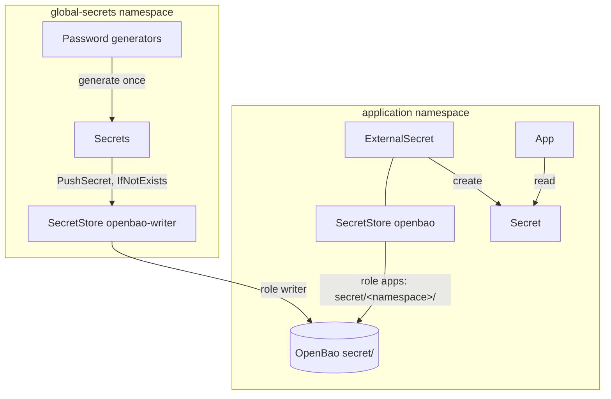

# Step 8a: OpenBao behind External Secrets Implementation Plan

> **For agentic workers:** REQUIRED SUB-SKILL: Use superpowers:subagent-driven-development (recommended) or superpowers:executing-plans to implement this plan task-by-task. Steps use checkbox (`- [ ]`) syntax for tracking.

**Goal:** OpenBao in the cluster holds the homelab's secrets. Each namespace reads only `secret/<namespace>/*` through its own `SecretStore` `openbao`. Generated secrets are pushed into OpenBao once. OpenBao unseals itself with a key OpenTofu keeps, and configures itself from git.

**Architecture:**
- OpenTofu unit `infra/<env>/openbao` creates the unseal key and the Secret `openbao/openbao-unseal`.
- `platform/openbao` wraps the official chart. It runs a static seal, raft storage and self-initialisation (KV v2, Kubernetes auth, policies `apps`/`writer`/`admin` and their roles).
- `system/secret-store` is an extra source on every Application, like `system/egress`. It renders the namespace's `SecretStore`.
- `platform/global-secrets` pushes each generated value to its readers' branches. The `ClusterSecretStore` is removed and every consumer moves to the new store.

**Tech Stack:** OpenBao 2.7.1 (chart `openbao` 0.30.4), External Secrets 2.12.0 (`ExternalSecret` v1, `PushSecret` v1alpha1), OpenTofu + Terragrunt (hashicorp/random 3.9.1), Helm, Go terratest, Python checks.

**Spec:** `docs/superpowers/specs/2026-10-17-openbao-design.md`

## Global Constraints

- Versions are pinned exactly: OpenBao image `quay.io/openbao/openbao:2.7.1`, chart `openbao` 0.30.4 from `https://openbao.github.io/openbao-helm`, hashicorp/random 3.9.1.
- Seal: `seal "static"`, key id `homelab-1`, key file `/openbao/unseal/key` from Secret `openbao/openbao-unseal`, key `key`, 32 raw bytes.
- KV v2 at `secret/`. Key layout is `secret/<namespace>/<name>`. Properties are unchanged (`password`, `secret`, `PAPERLESS_ADMIN_PASSWORD`, …).
- Roles:
  - `apps`: service account `default` in any namespace, policy `apps` (read `secret/data/<own namespace>/*`).
  - `writer`: `default` in `global-secrets`. Policy `writer` grants create, read and update on `secret/data/*` and `secret/metadata/*`.
  - `admin`: `openbao-admin` in `openbao`, policy `admin` (everything).
- The store every namespace reads is `SecretStore` `openbao` (role `apps`, SA `default`, server `http://openbao.openbao.svc.cluster.local:8200`). The writer's store is `SecretStore` `openbao-writer` in `global-secrets`.
- Destinations:
  - `forgejo.admin` → `forgejo/admin`, `argocd/forgejo-admin`
  - `grafana.admin` → `grafana/admin`
  - `paperless.admin` → `paperless/admin`
  - `paperless.secret-key` → `paperless/secret-key`
  - `registry.ci` → `zot/ci`
  - `woodpecker.agent` → `woodpecker/agent`
- Paths nobody creates yet: `woodpecker/forgejo`, `renovate/forgejo`, `wireguard/private-key`, `tailscale/auth-key`.
- Rules from `CLAUDE.md`:
  - No IP address in charts.
  - Write hosts as `<host>.{{ .Values.global.baseDomain }}`.
  - Every meshed namespace has an `allow` AuthorizationPolicy.
  - Helm replaces lists, so the prod, dev and seed ApplicationSets each restate `sources`.
  - Never put personal data or secret values in the repo or in logs.
- Basic checks:
  - `scripts/render-chart <dir>` and `scripts/render-chart <dir> dev` for every changed chart or app file
  - `cd test && go vet ./... && go test -run 'TestSmokeAppsForEnv|TestIdentity(HasGroup|TOTPWaitsForNextStep|PKCE)|TestGatewayRouteReady|TestGatewayNodeAddressFromInspect' ./...`
  - `mkdocs build --strict`
  - `scripts/check-mesh-policies`
  - `scripts/check-env-config`
  - `make -C infra check`
  - from Task 4: `scripts/check-secret-stores`

## Review Focus

1. **Self-init request failing on a fresh cluster.** A typo in the HCL, or Helm's `tpl` eating the OpenBao template braces, leaves OpenBao unsealed but empty. Expect the sandbox tests to fail on it at once, never a silent half-configured store. Task 2 pins the rendered template line. Task 5's tests read through every role.
2. **First sync ordering.** ESO's CRDs, OpenBao and the unseal Secret appear in any order. Expect every `SecretStore`, `PushSecret` and `ExternalSecret` to become ready without manual help: ESO retries on errors, Argo CD re-renders when the capability appears, and the pod waits for the Secret. Task 7's fresh `make dev` is the proof. Watch zot, whose StatefulSet waits for its Secret.
3. **OpenBao restarting or losing its pod.** Expect it to come back unsealed with its data, and self-init not to run twice. Task 5 covers this with `TestSecretsSurviveRestart`.
4. **A namespace naming another's key.** Expect ESO to refuse the read, and `scripts/check-secret-stores` to refuse the render before merge. Task 4 covers the check. Task 5 covers the refusal with `TestSecretsNamespaceBranches`.
5. **Re-running `make dev` on an existing sandbox.** Expect the unit not to replace the key (OpenBao would stay sealed with the old data). Task 1 covers this: the key's resource has no trigger, and a second plan shows no changes.

---

### Task 1: OpenTofu unit `openbao` (unseal key)

**Files:**
- Create: `infra/_modules/openbao/main.tf`
- Create: `infra/_modules/openbao/apply-secret.sh`
- Create: `infra/sandbox/openbao/terragrunt.hcl`
- Create: `infra/production/openbao/terragrunt.hcl`

**Interfaces:**
- Consumes: `infra/root.hcl` (input `kubeconfig`, local state, the chmod hook); `infra/sandbox/cluster` output `cluster_id`.
- Produces: Secret `openbao/openbao-unseal` with key `key` (32 bytes). Task 2 mounts it.

- [ ] **Step 1: Write the failing check**

Run: `cd infra/sandbox/openbao && terragrunt plan`
Expected: FAIL (`infra/sandbox/openbao` does not exist).

- [ ] **Step 2: Write the module**

`infra/_modules/openbao/main.tf`:

```hcl
# OpenBao's unseal key (platform/openbao reads it from Secret openbao/openbao-unseal; seal "static"). The key lives in
# this unit's state, outside the cluster: losing it loses everything OpenBao holds
terraform {
  required_version = ">= 1.13"
  required_providers {
    random = {
      source  = "hashicorp/random"
      version = "3.9.1"
    }
  }
}

variable "kubeconfig" {
  type = string
}

variable "namespace" {
  type        = string
  default     = "openbao"
  description = "Namespace of platform/openbao, created by Argo CD"
}

variable "cluster_id" {
  type        = string
  default     = ""
  description = "Identity of the cluster: a new cluster gets the Secret again (same key)"
}

variable "protect" {
  type        = bool
  default     = false
  description = "Refuse to destroy the key (production)"
}

# prevent_destroy cannot take a variable: one resource per setting, only one of them exists
resource "random_bytes" "key" {
  count  = var.protect ? 0 : 1
  length = 32
}

resource "random_bytes" "protected" {
  count  = var.protect ? 1 : 0
  length = 32

  lifecycle {
    prevent_destroy = true
  }
}

locals {
  key = one(concat(random_bytes.key[*].base64, random_bytes.protected[*].base64))
}

resource "terraform_data" "secret" {
  triggers_replace = [var.cluster_id, var.namespace, sha256(local.key)]

  provisioner "local-exec" {
    command = "sh ${abspath("${path.module}/apply-secret.sh")}"
    environment = {
      KUBECONFIG = var.kubeconfig
      NAMESPACE  = var.namespace
      KEY        = local.key
    }
  }
}
```

`infra/_modules/openbao/apply-secret.sh`:

```sh
#!/bin/sh
# Writes OpenBao's unseal key into its namespace once Argo CD has created it. The key comes in base64 through the
# environment and reaches kubectl on stdin: never in an argument or a file
set -eu
: "${KUBECONFIG:?}" "${NAMESPACE:?}" "${KEY:?}"
if ! kubectl wait --for=create "namespace/$NAMESPACE" --timeout=30m >/dev/null; then
  echo "namespace $NAMESPACE did not appear in 30 minutes: is Argo CD syncing platform/openbao?" >&2
  exit 1
fi
printf '%s' "$KEY" | base64 -d |
  kubectl -n "$NAMESPACE" create secret generic openbao-unseal --from-file=key=/dev/stdin --dry-run=client -o yaml |
  kubectl apply --server-side --field-manager=infra-openbao -f - >/dev/null
echo "Secret $NAMESPACE/openbao-unseal applied"
```

`infra/sandbox/openbao/terragrunt.hcl`:

```hcl
include "root" {
  path = find_in_parent_folders("root.hcl")
}

# A new cluster (its id changes) gets the Secret again
dependency "cluster" {
  config_path                             = "../cluster"
  mock_outputs                            = { cluster_id = "not-created-yet" }
  mock_outputs_allowed_terraform_commands = ["validate", "plan"]
}

# Argo CD creates namespace openbao when it syncs platform/openbao
dependencies {
  paths = ["../argocd"]
}

terraform {
  source = "${find_in_parent_folders("_modules")}//openbao"
}

inputs = {
  cluster_id = dependency.cluster.outputs.cluster_id
}
```

`infra/production/openbao/terragrunt.hcl`:

```hcl
include "root" {
  path = find_in_parent_folders("root.hcl")
}

# Argo CD creates namespace openbao when it syncs platform/openbao
dependencies {
  paths = ["../argocd"]
}

terraform {
  source = "${find_in_parent_folders("_modules")}//openbao"
}

inputs = {
  protect = true
}
```

- [ ] **Step 3: Run the offline checks and the plans**

Run: `make -C infra check && (cd infra/sandbox/openbao && terragrunt plan -no-color 2>&1 | grep -E 'Plan:|Error') && (cd infra/production/openbao && terragrunt plan -no-color 2>&1 | grep -E 'Plan:|Error')`
Expected: the checks pass. Each plan shows `Plan: 2 to add, 0 to change, 0 to destroy.` (production reads no cluster, so its plan needs no kubeconfig).

- [ ] **Step 4: Prove the script against the running sandbox in a throwaway namespace**

Run (sandbox up; `KUBECONFIG=$PWD/infra/sandbox/kubeconfig.yaml`):

```sh
export KUBECONFIG=$PWD/infra/sandbox/kubeconfig.yaml
( sleep 5; kubectl create namespace openbao-unit-test ) &
NAMESPACE=openbao-unit-test KEY=$(head -c 32 /dev/urandom | base64 -w0) sh infra/_modules/openbao/apply-secret.sh
kubectl -n openbao-unit-test get secret openbao-unseal -o jsonpath='{.data.key}' | base64 -d | wc -c
NAMESPACE=openbao-never KEY=eA== timeout 5 sh infra/_modules/openbao/apply-secret.sh; echo "exit=$?"
kubectl delete namespace openbao-unit-test
```

Expected:
- The first run waits, then prints `Secret openbao-unit-test/openbao-unseal applied`.
- `wc -c` prints `32`.
- The second run is killed by `timeout`: `exit=124`. It only shows that the wait blocks; the 30-minute message is read in the script, not waited for.

- [ ] **Step 5: Commit**

```bash
git add infra/_modules/openbao infra/sandbox/openbao infra/production/openbao
git commit -m "feat(infra): openbao unit creates OpenBao's unseal key and Secret"
```

---

### Task 2: `platform/openbao`

**Files:**
- Create: `platform/openbao/Chart.yaml`
- Create: `platform/openbao/values.yaml`
- Create: `platform/openbao/templates/admin-serviceaccount.yaml`
- Create: `platform/openbao/templates/authorization-policy.yaml`
- Modify: `scripts/check-mesh-policies` (the `EXTRA` list)
- Modify: `system/argocd/values-dev.yaml` (root directories: add `platform/openbao` after `platform/external-secrets`)

**Interfaces:**
- Consumes: Secret `openbao/openbao-unseal` (Task 1).
- Produces:
  - Service `openbao.openbao.svc.cluster.local:8200` (plain HTTP inside the mesh)
  - Kubernetes auth mount `kubernetes`
  - roles `apps`, `writer`, `admin`
  - KV v2 mount `secret`
  - pod `openbao-0`, container `openbao`
  - ServiceAccount `openbao/openbao-admin`

- [ ] **Step 1: Write the failing checks**

Add to `EXTRA` in `scripts/check-mesh-policies`, after the Kanidm line:

```python
    ("platform/openbao", "cluster.local/ns/external-secrets/sa/external-secrets", 8200, None,
     "External Secrets reads (SecretStore openbao) and pushes (openbao-writer) secrets"),
```

Run: `scripts/check-mesh-policies; scripts/render-chart platform/openbao | grep -c 'identity.entity.aliases'`
Expected: `check-mesh-policies` passes, because `EXTRA` lines for a component that is not rendered are ignored. `render-chart` fails because `platform/openbao` does not exist. Both commands are re-run in Step 3.

- [ ] **Step 2: Write the chart**

`platform/openbao/Chart.yaml`:

```yaml
apiVersion: v2
name: openbao
version: 0.0.0
dependencies:
  - name: openbao
    version: 0.30.4
    repository: https://openbao.github.io/openbao-helm
```

`platform/openbao/values.yaml`:

```yaml
openbao:
  injector:
    enabled: false
  ui:
    enabled: false
  server:
    image:
      tag: 2.7.1
    dataStorage:
      size: 1Gi
    # OpenTofu's unit infra/<env>/openbao writes this Secret; the pod waits for it
    volumes:
      - name: unseal
        secret:
          secretName: openbao-unseal
    volumeMounts:
      - name: unseal
        mountPath: /openbao/unseal
        readOnly: true
    standalone:
      enabled: true
      # The chart passes this through Helm's tpl: OpenBao's own template (policy apps) is wrapped in {{` `}}.
      # Self-initialisation runs once, on an empty storage; changing it later needs the admin role
      # (docs/concepts/secrets-management.md). HOSTNAME is replaced by the pod name at start.
      config: |
        ui = false
        disable_mlock = true

        # Plain HTTP: ztunnel's mTLS carries every connection inside the mesh
        listener "tcp" {
          address         = "[::]:8200"
          cluster_address = "[::]:8201"
          tls_disable     = true
        }

        storage "raft" {
          path    = "/openbao/data"
          node_id = "HOSTNAME"
        }

        seal "static" {
          current_key_id = "homelab-1"
          current_key    = "file:///openbao/unseal/key"
        }

        initialize "mounts" {
          request "kv" {
            operation = "update"
            path      = "sys/mounts/secret"
            data = {
              type    = "kv"
              options = { version = "2" }
            }
          }
          request "kubernetes" {
            operation = "update"
            path      = "sys/auth/kubernetes"
            data      = { type = "kubernetes" }
          }
          request "kubernetes-config" {
            operation = "update"
            path      = "auth/kubernetes/config"
            data      = { kubernetes_host = "https://kubernetes.default.svc" }
          }
          # Its accessor names the namespace in policy apps
          request "kubernetes-read" {
            operation = "read"
            path      = "sys/auth/kubernetes"
          }
        }

        initialize "policies" {
          # A namespace's default service account reads its own branch, secret/<namespace>/
          request "apps" {
            operation = "update"
            path      = "sys/policies/acl/apps"
            data = {
              policy = {
                eval_type   = "string"
                eval_source = "template"
                template    = "{{`path \"secret/data/{{ \"{{\" }}identity.entity.aliases.{{ (index .responses.mounts \"kubernetes-read\").data.accessor }}.metadata.service_account_namespace{{ \"}}\" }}/*\" { capabilities = [\"read\"] }`}}"
              }
            }
          }
          # platform/global-secrets pushes generated secrets; External Secrets reads a path and its metadata before
          # it writes them, so the writer reads too. IfNotExists keeps existing values
          request "writer" {
            operation = "update"
            path      = "sys/policies/acl/writer"
            data = {
              policy = "path \"secret/data/*\" { capabilities = [\"create\", \"read\", \"update\"] }\npath \"secret/metadata/*\" { capabilities = [\"create\", \"read\", \"update\"] }"
            }
          }
          # Emergency access: no root token exists
          request "admin" {
            operation = "update"
            path      = "sys/policies/acl/admin"
            data = {
              policy = "path \"*\" { capabilities = [\"create\", \"read\", \"update\", \"patch\", \"delete\", \"list\", \"sudo\"] }"
            }
          }
        }

        initialize "roles" {
          request "apps" {
            operation = "update"
            path      = "auth/kubernetes/role/apps"
            data = {
              bound_service_account_names      = ["default"]
              bound_service_account_namespaces = ["*"]
              token_policies                   = ["apps"]
              token_ttl                        = "10m"
            }
          }
          request "writer" {
            operation = "update"
            path      = "auth/kubernetes/role/writer"
            data = {
              bound_service_account_names      = ["default"]
              bound_service_account_namespaces = ["global-secrets"]
              token_policies                   = ["writer"]
              token_ttl                        = "10m"
            }
          }
          request "admin" {
            operation = "update"
            path      = "auth/kubernetes/role/admin"
            data = {
              bound_service_account_names      = ["openbao-admin"]
              bound_service_account_namespaces = ["openbao"]
              token_policies                   = ["admin"]
              token_ttl                        = "1h"
            }
          }
        }
```

`platform/openbao/templates/admin-serviceaccount.yaml`:

```yaml
# Emergency access (role admin): kubectl -n openbao create token openbao-admin, then log in with it
# (docs/concepts/secrets-management.md)
apiVersion: v1
kind: ServiceAccount
metadata:
  name: openbao-admin
  namespace: {{ .Release.Namespace }}
```

`platform/openbao/templates/authorization-policy.yaml`:

```yaml
# Under the mesh-wide deny-all (system/istio-system): who may call into this namespace
apiVersion: security.istio.io/v1
kind: AuthorizationPolicy
metadata:
  name: allow
  namespace: {{ .Release.Namespace }}
spec:
  action: ALLOW
  rules:
    # Pods in this namespace call each other freely
    - from:
        - source:
            namespaces: ["{{ .Release.Namespace }}"]
    # External Secrets' controller reads every namespace's branch and pushes generated secrets
    - from:
        - source:
            principals: ["cluster.local/ns/external-secrets/sa/external-secrets"]
      to:
        - operation:
            ports: ["8200"]
```

In `system/argocd/values-dev.yaml`, under the root generator's `directories`, after `- path: platform/external-secrets`:

```yaml
                    - path: platform/openbao
```

- [ ] **Step 3: Run the checks**

Run:

```sh
scripts/render-chart platform/openbao > /tmp/bao.yaml && scripts/render-chart platform/openbao dev > /dev/null
grep -F 'template    = "path \"secret/data/{{ \"{{\" }}identity.entity.aliases.{{ (index .responses.mounts \"kubernetes-read\").data.accessor }}.metadata.service_account_namespace{{ \"}}\" }}/*\" { capabilities = [\"read\"] }"' /tmp/bao.yaml | wc -l
yq 'select(.kind == "StatefulSet") | .spec.template.spec.containers[0].image' /tmp/bao.yaml
yq 'select(.kind == "ClusterRoleBinding") | .roleRef.name' /tmp/bao.yaml
scripts/check-mesh-policies && scripts/check-env-config
```

Expected:
- `grep` prints `1`: the OpenBao template survives Helm's `tpl`.
- The image is `quay.io/openbao/openbao:2.7.1`.
- The ClusterRoleBinding is `system:auth-delegator`.
- Both checks pass. `check-mesh-policies` now sees the External Secrets rule.

Then RED for the mesh rule: delete the External Secrets rule from the authorization policy and re-run `scripts/check-mesh-policies`. Expected: FAIL naming `platform/openbao` and port 8200. Restore the rule and re-run. Expected: pass.

- [ ] **Step 4: Commit**

```bash
git add platform/openbao/Chart.yaml platform/openbao/values.yaml platform/openbao/templates scripts/check-mesh-policies system/argocd/values-dev.yaml
git commit -m "feat(openbao): OpenBao with a static seal and self-initialisation (KV, Kubernetes auth, apps/writer/admin)"
```

---

### Task 3: `system/secret-store` on every Application

**Files:**
- Create: `system/secret-store/Chart.yaml`
- Create: `system/secret-store/values.yaml`
- Create: `system/secret-store/templates/secret-store.yaml`
- Modify: `system/argocd/values.yaml` (root generator excludes `system/secret-store`; both ApplicationSets add the source)
- Modify: `system/argocd/values-dev.yaml` (both ApplicationSets add the source)
- Modify: `system/argocd/values-seed.yaml` (root generator excludes it; both ApplicationSets add the source)
- Modify: `scripts/render-chart` (adds the `external-secrets.io/v1/SecretStore` API)
- Modify: `scripts/check-env-config` (the shared sources and their `exclude`)

**Interfaces:**
- Consumes: Service from Task 2; role `apps`.
- Produces: `SecretStore` `openbao` in every Argo CD namespace except `istio-system` and `rook-ceph`. Task 4's consumers reference it as `secretStoreRef: {kind: SecretStore, name: openbao}`.

- [ ] **Step 1: Write the failing check**

In `scripts/check-env-config`, replace the block that starts at `# Every Application renders system/egress` and ends at the root-generator check with:

```python
            # Every Application renders system/egress (default-deny egress) and system/secret-store (its OpenBao
            # SecretStore) into its namespace
            for shared in SHARED:
                found = [s for s in spec["template"]["spec"].get("sources") or [] if s.get("path") == shared]
                if not found:
                    failures.append(f"system/argocd ({env}): ApplicationSet/{doc['metadata']['name']} lacks the {shared} source")
                elif "addresses" not in found[0].get("helm", {}).get("valuesObject", {}).get("global", {}):
                    failures.append(f"system/argocd ({env}): ApplicationSet/{doc['metadata']['name']} does not pass global.addresses to {shared}")
                if doc["metadata"]["name"] == "root":
                    dirs = generators[0].get("git", {}).get("directories", [])
                    if any(d.get("path") in ("system/*", shared) for d in dirs) and not any(
                            d.get("path") == shared and d.get("exclude") for d in dirs):
                        failures.append(f"system/argocd ({env}): the root generator would deploy {shared} on its own")
```

Add near `EGRESS`:

```python
# Charts every Application renders into its namespace as an extra source (system/argocd/values.yaml)
SHARED = ("system/egress", "system/secret-store")
```

After `egress_values` is loaded:

```python
    # The same namespaces stay out of both shared charts (keep in step with the root templatePatch)
    with open("system/secret-store/values.yaml") as f:
        if yaml.safe_load(f).get("exclude") != egress_values.get("exclude"):
            failures.append("system/secret-store: exclude differs from system/egress's")
```

Run: `scripts/check-env-config 2>&1 | tail -8`
Expected: FAIL with `lacks the system/secret-store source` for root and apps in prod, dev and seed, and an error that `system/secret-store/values.yaml` does not exist.

- [ ] **Step 2: Write the chart**

`system/secret-store/Chart.yaml`:

```yaml
apiVersion: v2
name: secret-store
version: 0.0.0
```

`system/secret-store/values.yaml`:

```yaml
# Every Application renders this chart into its own namespace (system/argocd/values.yaml): the namespace's
# ExternalSecrets read their branch of OpenBao, secret/<namespace>/ (platform/openbao, role apps)

# Same as system/egress (scripts/check-env-config compares them)
exclude: [istio-system, rook-ceph]

server: http://openbao.openbao.svc.cluster.local:8200
```

`system/secret-store/templates/secret-store.yaml`:

```yaml
{{- /* Rendered once External Secrets' CRDs exist: Argo CD renders again when they appear */}}
{{- if and (not (has .Release.Namespace .Values.exclude)) (.Capabilities.APIVersions.Has "external-secrets.io/v1/SecretStore") }}
apiVersion: external-secrets.io/v1
kind: SecretStore
metadata:
  name: openbao
  namespace: {{ .Release.Namespace }}
spec:
  provider:
    vault:
      server: {{ .Values.server }}
      path: secret
      version: v2
      auth:
        kubernetes:
          mountPath: kubernetes
          role: apps
          serviceAccountRef:
            name: default
{{- end }}
```

In `scripts/render-chart`, extend the External Secrets line:

```sh
set -- "$@" --api-versions kaniop.rs/v1beta1/KanidmOAuth2Client --api-versions external-secrets.io/v1/ExternalSecret \
  --api-versions external-secrets.io/v1/SecretStore
```

In `system/argocd/values.yaml`, root generator `directories`, after the `system/egress` exclusion:

```yaml
                    # Rendered into every namespace by each Application (template below), not on its own
                    - path: system/secret-store
                      exclude: true
```

Then, in the root template's `sources`, after the `&egress` source:

```yaml
            # The namespace's SecretStore openbao (its branch of OpenBao)
            - &secretStore
              repoURL: *repoURL
              path: system/secret-store
              targetRevision: *revision
              helm:
                valuesObject: *values
```

In the `apps` template's `sources`, after `- *egress`, add `- *secretStore`.

Make the same three edits in `system/argocd/values-seed.yaml`: the exclusion, the `&secretStore` source after its `&egress`, and `- *secretStore` in apps. In `system/argocd/values-dev.yaml`, add the `&secretStore` source after its `&egress` and `- *secretStore` in apps. The dev root lists explicit directories, so it needs no exclusion.

- [ ] **Step 3: Run the checks**

Run:

```sh
scripts/check-env-config
helm template x system/secret-store --namespace grafana --api-versions external-secrets.io/v1/SecretStore | yq '.kind + "/" + .metadata.name'
helm template x system/secret-store --namespace istio-system --api-versions external-secrets.io/v1/SecretStore | wc -l
helm template x system/secret-store --namespace grafana | wc -l
for e in prod dev seed; do scripts/render-chart system/argocd $e > /dev/null || echo "argocd $e failed"; done
```

Expected:
- `check-env-config` reports `0 failures`.
- `SecretStore/openbao` is printed.
- Both `wc -l` lines print `0`: istio-system is excluded, and the CRD is not yet known.
- No `failed` lines.

- [ ] **Step 4: Commit**

```bash
git add system/secret-store system/argocd/values.yaml system/argocd/values-dev.yaml system/argocd/values-seed.yaml scripts/render-chart scripts/check-env-config
git commit -m "feat(secret-store): every Application renders its namespace's SecretStore openbao"
```

---

### Task 4: Push generated secrets into OpenBao; consumers read `SecretStore` `openbao`

The `ClusterSecretStore` goes in the same commit as the consumers' move: otherwise the tree has a commit where secrets cannot be read.

**Files:**
- Create: `scripts/check-secret-stores`
- Modify: `platform/global-secrets/values.yaml` (destinations)
- Create: `platform/global-secrets/templates/push-secrets.yaml`
- Create: `platform/global-secrets/templates/secret-store.yaml` (`openbao-writer`)
- Delete: `platform/global-secrets/templates/clustersecretstore/` (all four files)
- Modify: `platform/forgejo/templates/admin-secret.yaml`, `system/argocd/templates/forgejo-repository.yaml`, `platform/grafana/templates/admin-secret.yaml`, `platform/zot/templates/auth-secret.yaml`, `platform/woodpecker/templates/secret.yaml`, `platform/renovate/templates/secret.yaml`, `apps/paperless.yaml`, `apps/wireguard.yaml`, `apps/tailscale.yaml`

**Interfaces:**
- Consumes: `SecretStore` `openbao` (Task 3), role `writer` (Task 2).
- Produces: values at the destinations listed in Global Constraints. The generated Kubernetes Secrets in `global-secrets` stay, and `test/` reads them.

- [ ] **Step 1: Write the failing check**

`scripts/check-secret-stores`:

```python
#!/usr/bin/env python3
"""Every ExternalSecret reads OpenBao through its namespace's SecretStore, inside its namespace's branch.

Renders every component and app file in production and the sandbox (scripts/render-chart) and fails on:
- an ExternalSecret that reads anything but SecretStore openbao (system/secret-store);
- a key outside secret/<namespace>/, where the namespace is the component's (Argo CD's destination);
- a PushSecret outside platform/global-secrets, or through any store but its openbao-writer;
- any ClusterSecretStore.
ExternalSecrets that only run generators (platform/global-secrets) read no store.
"""

import glob
import os
import subprocess
import sys
import time

import yaml


class Loader(yaml.SafeLoader):
    """SafeLoader that reads a bare `=` (YAML 1.1's value tag, used by some charts) as a string."""


Loader.add_constructor("tag:yaml.org,2002:value", lambda loader, node: loader.construct_scalar(node))

WRITER = ("platform/global-secrets", "openbao-writer")


def render(target, env):
    # Chart downloads sometimes reset the connection: try three times
    for attempt in range(3):
        out = subprocess.run(["scripts/render-chart", target, env], capture_output=True, text=True)
        if out.returncode == 0:
            return [d for d in yaml.load_all(out.stdout, Loader=Loader) if d]
        time.sleep(5)
    sys.exit(f"render failed: {target} {env}\n{out.stderr}")


def targets():
    dirs = sorted(glob.glob("system/*/") + glob.glob("platform/*/") + glob.glob("apps/*/"))
    return [d.rstrip("/") for d in dirs if glob.glob(d + "Chart.yaml")] + sorted(glob.glob("apps/*.yaml"))


def keys(spec):
    for item in spec.get("data") or []:
        yield item["remoteRef"]["key"]
    for item in spec.get("dataFrom") or []:
        if "extract" in item:
            yield item["extract"]["key"]
        elif "find" in item:
            yield None  # find searches the whole store: never allowed


def generators_only(spec):
    sources = spec.get("dataFrom") or []
    return not spec.get("data") and sources and all("generatorRef" in (s.get("sourceRef") or {}) for s in sources)


def main():
    failures = []
    for env in ("prod", "dev"):
        for target in targets():
            namespace = os.path.basename(target).removesuffix(".yaml")
            for doc in render(target, env):
                kind, name = doc.get("kind"), (doc.get("metadata") or {}).get("name")
                spec = doc.get("spec") or {}
                where = f"{target} ({env}): {kind}/{name}"
                if kind == "ClusterSecretStore":
                    failures.append(f"{where}: use the namespace's SecretStore openbao (system/secret-store)")
                elif kind == "ExternalSecret":
                    if generators_only(spec):
                        continue
                    ref = spec.get("secretStoreRef") or {}
                    if (ref.get("kind", "SecretStore"), ref.get("name")) != ("SecretStore", "openbao"):
                        failures.append(f"{where}: reads {ref.get('kind', 'SecretStore')}/{ref.get('name')}, not SecretStore/openbao")
                    for key in keys(spec):
                        if key is None or not key.startswith(namespace + "/"):
                            failures.append(f"{where}: key {key} is outside its branch {namespace}/")
                elif kind == "PushSecret":
                    stores = [(r.get("kind", "SecretStore"), r.get("name")) for r in spec.get("secretStoreRefs") or []]
                    if (target, stores) != (WRITER[0], [("SecretStore", WRITER[1])]):
                        failures.append(f"{where}: only {WRITER[0]} pushes, through SecretStore {WRITER[1]}")
    for f in failures:
        print(f, file=sys.stderr)
    print(f"check-secret-stores: {len(failures)} failures")
    sys.exit(1 if failures else 0)


if __name__ == "__main__":
    main()
```

Run: `chmod +x scripts/check-secret-stores && scripts/check-secret-stores 2>&1 | tail -15`
Expected: FAIL. It reports `reads ClusterSecretStore/global-secrets` for each of the 9 consumers in both environments, and `use the namespace's SecretStore openbao` for global-secrets' store.

- [ ] **Step 2: Push from `platform/global-secrets`**

`platform/global-secrets/values.yaml` becomes:

```yaml
# Random secrets generated once per cluster (Password generators, Secrets in this namespace) and pushed once to each
# reader's branch of OpenBao, secret/<namespace>/<name> (templates/push-secrets.yaml); readers use their namespace's
# SecretStore openbao. Never rotated automatically; see docs/concepts/secrets-management.md.
secrets:
  - name: forgejo.admin
    key: password
    special: true
    # Argo CD reads the GitOps repository with it
    destinations: [forgejo/admin, argocd/forgejo-admin]
  - name: woodpecker.agent
    key: secret
    destinations: [woodpecker/agent]
  - name: paperless.admin
    key: PAPERLESS_ADMIN_PASSWORD
    special: true
    destinations: [paperless/admin]
  # paperless 3 refuses to start without it
  - name: paperless.secret-key
    key: PAPERLESS_SECRET_KEY
    length: 64
    destinations: [paperless/secret-key]
  - name: grafana.admin
    key: password
    special: true
    destinations: [grafana/admin]
  - name: registry.ci
    key: password
    destinations: [zot/ci]
# Environment-specific additions, so the list above does not have to be restated
extraSecrets: []
```

`platform/global-secrets/templates/push-secrets.yaml`:

```yaml
{{- range concat .Values.secrets .Values.extraSecrets }}
{{- $entry := . }}
{{- if .destinations }}
---
apiVersion: external-secrets.io/v1alpha1
kind: PushSecret
metadata:
  name: {{ .name }}
  namespace: {{ $.Release.Namespace }}
spec:
  # An existing value is never replaced; the hourly check pushes a missing one again (an OpenBao that lost its data)
  refreshInterval: 1h
  updatePolicy: IfNotExists
  deletionPolicy: None
  secretStoreRefs:
    - kind: SecretStore
      name: openbao-writer
  selector:
    secret:
      name: {{ .name }}
  data:
    {{- range .destinations }}
    - match:
        secretKey: {{ $entry.key }}
        remoteRef:
          remoteKey: {{ . }}
          property: {{ $entry.key }}
    {{- end }}
{{- end }}
{{- end }}
```

`platform/global-secrets/templates/secret-store.yaml`:

```yaml
# Writes generated secrets into OpenBao (role writer: this namespace's default service account; platform/openbao)
apiVersion: external-secrets.io/v1
kind: SecretStore
metadata:
  name: openbao-writer
  namespace: {{ .Release.Namespace }}
spec:
  provider:
    vault:
      server: http://openbao.openbao.svc.cluster.local:8200
      path: secret
      version: v2
      auth:
        kubernetes:
          mountPath: kubernetes
          role: writer
          serviceAccountRef:
            name: default
```

Run: `git rm -r -q platform/global-secrets/templates/clustersecretstore`

- [ ] **Step 3: Move the consumers**

In each file below, replace

```yaml
    secretStoreRef:
      kind: ClusterSecretStore
      name: global-secrets
```

with

```yaml
    secretStoreRef:
      kind: SecretStore
      name: openbao
```

Keep each file's own indentation: 2 spaces for chart templates (`spec:` children), 4 for the app files' `rawResources`/`externalSecrets` entries. Then change the keys:

| File | Old `key` / `property` | New `key` / `property` |
|---|---|---|
| `platform/forgejo/templates/admin-secret.yaml` | `forgejo.admin` / `password` | `forgejo/admin` / `password` |
| `system/argocd/templates/forgejo-repository.yaml` | `forgejo.admin` / `password` | `argocd/forgejo-admin` / `password` |
| `platform/grafana/templates/admin-secret.yaml` | `grafana.admin` / `password` | `grafana/admin` / `password` |
| `platform/zot/templates/auth-secret.yaml` | `registry.ci` / `password` | `zot/ci` / `password` |
| `platform/woodpecker/templates/secret.yaml` | `forgejo.woodpecker` / `client_id`, `client_secret`; `woodpecker.agent` / `secret` | `woodpecker/forgejo` / `client_id`, `client_secret`; `woodpecker/agent` / `secret` |
| `platform/renovate/templates/secret.yaml` | `forgejo.renovate` / `token` | `renovate/forgejo` / `token` |
| `apps/paperless.yaml` (`dataFrom.extract`) | `paperless.admin`, `paperless.secret-key` | `paperless/admin`, `paperless/secret-key` |
| `apps/wireguard.yaml` | `external` / `wireguard-private-key` | `wireguard/private-key` / `private-key` |
| `apps/tailscale.yaml` | `external` / `tailscale-auth-key` | `tailscale/auth-key` / `auth-key` |

Also update these comments:
- `system/argocd/templates/forgejo-repository.yaml`: "Step 9 replaces the admin account with a read-only token in OpenBao" stays.
- `apps/wireguard.yaml`: the server's private key lives in OpenBao at `secret/wireguard/private-key` (property `private-key`), written in step 8b.
- `apps/tailscale.yaml`: one comment line above its `secretStoreRef` block, `# secret/tailscale/auth-key in OpenBao (property auth-key), written in step 8b`.

- [ ] **Step 4: Run the checks**

Run:

```sh
scripts/check-secret-stores
scripts/render-chart platform/global-secrets | yq 'select(.kind == "PushSecret") | .metadata.name + " " + ([.spec.data[].match.remoteRef.remoteKey] | join(","))'
for t in platform/global-secrets platform/forgejo platform/grafana platform/zot platform/woodpecker platform/renovate system/argocd apps/paperless.yaml apps/wireguard.yaml apps/tailscale.yaml; do for e in prod dev; do scripts/render-chart $t $e > /dev/null || echo "$t $e failed"; done; done
grep -rn "global-secrets" --include=*.yaml platform system apps | grep -v "^platform/global-secrets/" | grep -iv "#"
scripts/check-mesh-policies && scripts/check-env-config
```

Expected:
- `check-secret-stores: 0 failures`.
- Six PushSecrets: `forgejo.admin forgejo/admin,argocd/forgejo-admin`, `woodpecker.agent woodpecker/agent`, `paperless.admin paperless/admin`, `paperless.secret-key paperless/secret-key`, `grafana.admin grafana/admin`, `registry.ci zot/ci`.
- No `failed` lines. The `grep` finds nothing outside comments, apart from `system/argocd/values-dev.yaml`'s directory entry `platform/global-secrets`.
- Both checks pass.

Then RED for the branch rule: temporarily set `key: zot/ci` in `platform/grafana/templates/admin-secret.yaml` and run `scripts/check-secret-stores`. Expected: FAIL with `key zot/ci is outside its branch grafana/`. Restore it. Expected: `0 failures`.

- [ ] **Step 5: Commit**

```bash
git add scripts/check-secret-stores platform/global-secrets platform/forgejo platform/grafana platform/zot platform/woodpecker platform/renovate system/argocd/templates/forgejo-repository.yaml apps/paperless.yaml apps/wireguard.yaml apps/tailscale.yaml
git commit -m "feat(global-secrets): push generated secrets into OpenBao; every ExternalSecret reads SecretStore openbao"
```

---

### Task 5: Sandbox tests `test/secrets_test.go`

**Files:**
- Create: `test/secrets_test.go`
- Modify: `Makefile` (`smoke_filter` adds `Secrets`)

**Interfaces:**
- Consumes: pod `openbao/openbao-0` (container `openbao`, `bao` CLI, `BAO_ADDR` set by the chart), roles `apps`/`writer`/`admin`, ServiceAccount `openbao-admin`, `secretValue` (`test/sso_test.go`).
- Produces: `TestSecrets*`, run by `make dev`.

- [ ] **Step 1: Write the tests**

`test/secrets_test.go`:

```go
package test

import (
	"encoding/json"
	"os"
	"os/exec"
	"strings"
	"testing"
	"time"

	"github.com/gruntwork-io/terratest/modules/k8s"
	"github.com/gruntwork-io/terratest/modules/logger"
	"github.com/stretchr/testify/assert"
	"github.com/stretchr/testify/require"
)

func secretsSandboxOnly(t *testing.T) {
	if os.Getenv("ENV") != "dev" {
		t.Skip("OpenBao tests run against the sandbox only")
	}
}

// bao runs the OpenBao CLI in OpenBao's pod, logged in with a token of service account namespace/account and the
// given role. The token reaches the pod on stdin and is never logged
func bao(t *testing.T, role, namespace, account string, args ...string) (string, error) {
	options := k8s.NewKubectlOptions("", "", namespace)
	options.Logger = logger.Discard
	token, err := k8s.RunKubectlAndGetOutputE(t, options, "create", "token", account, "--duration=10m")
	require.NoError(t, err)
	script := `BAO_TOKEN="$(bao write -field=token auth/kubernetes/login role="$0" jwt=-)" && export BAO_TOKEN && exec bao "$@"`
	cmd := exec.Command("kubectl", append([]string{"-n", "openbao", "exec", "-i", "openbao-0", "-c", "openbao", "--",
		"sh", "-c", script, role}, args...)...)
	cmd.Stdin = strings.NewReader(token)
	out, err := cmd.CombinedOutput()
	return strings.TrimSpace(string(out)), err
}

// waitForUnsealed waits until OpenBao's pod answers, initialised and unsealed
func waitForUnsealed(t *testing.T) {
	require.Eventually(t, func() bool {
		out, err := exec.Command("kubectl", "-n", "openbao", "exec", "openbao-0", "-c", "openbao", "--",
			"bao", "status", "-format=json").Output()
		if err != nil {
			return false
		}
		var status struct {
			Initialized bool `json:"initialized"`
			Sealed      bool `json:"sealed"`
		}
		return json.Unmarshal(out, &status) == nil && status.Initialized && !status.Sealed
	}, 30*time.Minute, 10*time.Second, "OpenBao is not initialised and unsealed")
}

// grafanaAdmin reads Grafana's admin password from its branch, as Grafana's namespace, once global-secrets has
// pushed it
func grafanaAdmin(t *testing.T) string {
	var password string
	require.Eventually(t, func() bool {
		out, err := bao(t, "apps", "grafana", "default", "kv", "get", "-field=password", "secret/grafana/admin")
		password = out
		return err == nil && out != ""
	}, 20*time.Minute, 15*time.Second, "secret/grafana/admin is not readable")
	return password
}

func TestSecretsUnsealed(t *testing.T) {
	secretsSandboxOnly(t)
	waitForUnsealed(t)
}

// A namespace reads its own branch, not another's, and writes nowhere
func TestSecretsNamespaceBranches(t *testing.T) {
	secretsSandboxOnly(t)
	waitForUnsealed(t)
	assert.NotEmpty(t, grafanaAdmin(t))

	out, err := bao(t, "apps", "grafana", "default", "kv", "get", "-field=password", "secret/zot/ci")
	assert.Error(t, err, "grafana read zot's branch")
	assert.Contains(t, out, "permission denied")

	out, err = bao(t, "apps", "grafana", "default", "kv", "put", "secret/grafana/probe", "value=x")
	assert.Error(t, err, "grafana wrote to OpenBao")
	assert.Contains(t, out, "permission denied")
}

// The writer is global-secrets' default service account only
func TestSecretsWriterRole(t *testing.T) {
	secretsSandboxOnly(t)
	waitForUnsealed(t)
	out, err := bao(t, "writer", "grafana", "default", "kv", "get", "secret/grafana/admin")
	assert.Error(t, err, "grafana logged in as writer")
	assert.Contains(t, out, "not authorized")
}

// Emergency access: the admin role, for service account openbao-admin
func TestSecretsAdmin(t *testing.T) {
	secretsSandboxOnly(t)
	waitForUnsealed(t)
	out, err := bao(t, "admin", "openbao", "openbao-admin", "policy", "list")
	require.NoError(t, err, out)
	for _, policy := range []string{"apps", "writer", "admin"} {
		assert.Contains(t, strings.Fields(out), policy)
	}
}

// Grafana's admin Secret comes from OpenBao and equals the generated value
func TestSecretsReachConsumers(t *testing.T) {
	secretsSandboxOnly(t)
	waitForUnsealed(t)
	generated := secretValue(t, "global-secrets", "grafana.admin", "password")
	assert.Equal(t, generated, grafanaAdmin(t), "OpenBao's value differs from the generated one")
	require.Eventually(t, func() bool {
		return secretValue(t, "grafana", "grafana-admin", "admin-password") == generated
	}, 20*time.Minute, 15*time.Second, "grafana-admin does not hold the generated password")
}

// After its pod is replaced OpenBao unseals itself and keeps its data. Consumers keep their Secrets meanwhile; External
// Secrets retries the reads that fail while the pod restarts
func TestSecretsSurviveRestart(t *testing.T) {
	secretsSandboxOnly(t)
	waitForUnsealed(t)
	before := grafanaAdmin(t)
	k8s.RunKubectl(t, k8s.NewKubectlOptions("", "", "openbao"), "delete", "pod", "openbao-0", "--wait=true")
	waitForUnsealed(t)
	assert.Equal(t, before, grafanaAdmin(t))
}
```

`secretValue` in `test/sso_test.go` uses `k8s.GetSecret`, which fails the test while the Secret is missing. `TestSecretsReachConsumers` calls it inside `Eventually` only for `grafana-admin`, which Grafana's sync creates long before these tests run. If it flakes, ledger a ruling and switch to `k8s.GetSecretE`.

In `Makefile`, `smoke_filter` becomes `'Smoke|Identity|SSO|Gateway|Forgejo|Mesh|Monitoring|Egress|Secrets'`.

- [ ] **Step 2: Run the offline checks**

Run: `cd test && go vet ./... && go test -run 'TestSmokeAppsForEnv|TestIdentity(HasGroup|TOTPWaitsForNextStep|PKCE)|TestGatewayRouteReady|TestGatewayNodeAddressFromInspect|TestSecrets' ./...`
Expected: `ok`. The `TestSecrets*` tests skip without `ENV=dev`.

- [ ] **Step 3: RED against the current sandbox (no OpenBao yet)**

Run: `cd test && ENV=dev KUBECONFIG=$PWD/../infra/sandbox/kubeconfig.yaml timeout 90 go test -run TestSecretsAdmin -count=1 ./... 2>&1 | tail -5`
Expected: FAIL. `waitForUnsealed` keeps failing: no pod `openbao-0` in the sandbox. `timeout` stops it. Task 7 turns it green.

- [ ] **Step 4: Commit**

```bash
git add test/secrets_test.go Makefile
git commit -m "test(secrets): OpenBao unseals, keeps data, scopes reads per namespace, feeds consumers"
```

---

### Task 6: Docs and `CLAUDE.md`

**Files:**
- Modify: `docs/concepts/secrets-management.md`
- Modify: `docs/installation/sandbox.md` (lines 39, 82: the passwords still live in `global-secrets`; add "and in OpenBao")
- Modify: `CLAUDE.md`

- [ ] **Step 1: Rewrite `docs/concepts/secrets-management.md`**

Keep the sections "Generated secrets" (with the values snippet) and "Extra third-party secrets" (it still names `external/`; mark it "until step 8b"). Replace the Overview, the info box, the diagram and "How secrets are pulled" with:

````markdown
# Secrets management

## Overview

- [OpenBao](https://openbao.org) (`platform/openbao`) holds the cluster's secrets in its KV store `secret/`.
- Every namespace reads its own branch, `secret/<namespace>/<name>`, through its `SecretStore` `openbao`
  (`system/secret-store`, rendered by every Application) and [External Secrets](https://external-secrets.io)
  `ExternalSecret`s. OpenBao refuses a read of another namespace's branch.
- Generated secrets come from `platform/global-secrets`, which pushes each one to its readers' branches.



## Reading a secret

```yaml
apiVersion: external-secrets.io/v1
kind: ExternalSecret
metadata:
  name: grafana-admin
spec:
  secretStoreRef:
    kind: SecretStore
    name: openbao
  data:
    - secretKey: password
      remoteRef:
        key: grafana/admin  # secret/grafana/admin: the namespace's own branch
        property: password
```

`scripts/check-secret-stores` refuses, before merge, an `ExternalSecret` that reads another store or another
namespace's branch. A secret two namespaces need is pushed to both branches (`destinations` in
`platform/global-secrets/values.yaml`).

## Unsealing and configuration

- OpenBao unseals itself (`seal "static"`) with a 32-byte key that the OpenTofu unit `infra/<env>/openbao` creates,
  keeps in its state (`.state/`, readable only by you; Cloudflare R2 with state encryption from step 8c) and writes into
  Secret `openbao/openbao-unseal`. Losing the key loses everything OpenBao holds.
- On first start OpenBao configures itself from `platform/openbao/values.yaml` (`initialize` stanzas):
  - the KV v2 store `secret/` and Kubernetes auth;
  - the policies `apps` (read `secret/<namespace>/`), `writer` (push: `create`, `read`, `update` on everything,
    because External Secrets reads before it writes) and `admin`;
  - their roles: `apps` for every namespace's `default` service account, `writer` for `global-secrets`' and `admin`
    for `openbao/openbao-admin`.
- These stanzas run only on an empty storage: editing them later changes nothing on a running OpenBao. Apply the
  change by hand with the admin role (below), or, in the sandbox, `make dev-clean`.
- No root token and no recovery keys exist.
- OpenBao's data has no backup until step 10.

## Emergency access

```sh
token=$(kubectl -n openbao create token openbao-admin --duration=1h)
kubectl -n openbao exec -it openbao-0 -c openbao -- sh -c 'bao login -method=kubernetes role=admin jwt=-' <<<"$token"
kubectl -n openbao exec -it openbao-0 -c openbao -- sh
```

Anyone who can create tokens for `openbao-admin` (cluster admins) holds every secret.
````

Change the rotation steps under "Generated secrets" to:

```markdown
1. With the admin role: `bao kv metadata delete secret/<namespace>/<name>` for each destination of the entry.
2. `kubectl -n global-secrets delete secret <name>`. External Secrets generates a new value; its PushSecret writes it
   to the empty destinations within an hour (`kubectl -n global-secrets annotate pushsecret <name>
   force-sync=$(date +%s) --overwrite` pushes it at once).
3. Restart every app that uses it (for example `kubectl -n forgejo rollout restart deploy/forgejo`).
4. For an admin password, also change it inside the app to the new value.
```

Run `grep -n "ClusterSecretStore" docs/concepts/secrets-management.md`. Expected: nothing.

- [ ] **Step 2: `CLAUDE.md`**

- Roadmap item 8: `8. Secrets: 8a OpenBao behind ESO (static seal key from OpenTofu, self-initialisation, per-namespace SecretStore, generated secrets pushed) (done); 8b OpenTofu's secrets (Cloudflare, ntfy, extras) into OpenBao, `external/` removed; 8c OpenTofu state on Cloudflare R2 with state encryption`.
- Rules, the basic checks list: add `scripts/check-secret-stores` after `scripts/check-env-config`.
- Sandbox section: `make dev` runs `Smoke|Identity|SSO|Gateway|Forgejo|Mesh|Monitoring|Egress|Secrets`.
- Add a Sandbox bullet: `Secrets live in OpenBao (`platform/openbao`): a component's `ExternalSecret`s read `SecretStore` `openbao` (rendered in every namespace by `system/secret-store`) with keys under its own namespace (`<namespace>/<name>`); a value two namespaces need is pushed to both branches (`destinations` in `platform/global-secrets/values.yaml`); `scripts/check-secret-stores` checks it. OpenBao configures itself only on first start (its `initialize` stanzas): change a running one with the admin role (docs/concepts/secrets-management.md). Its unseal key comes from the OpenTofu unit `infra/<env>/openbao`.`
- Production checklist:
  - Replace the Woodpecker/Renovate bullet with: `Woodpecker and Renovate read `secret/woodpecker/forgejo` (`client_id`, `client_secret`) and `secret/renovate/forgejo` (`token`) from OpenBao, which nothing writes yet (step 9); wireguard and tailscale read `secret/wireguard/private-key` and `secret/tailscale/auth-key`, written in step 8b.`
  - Add: `OpenBao (static seal, self-initialisation, raft on a PVC) only ran in the sandbox. Its data has no backup until step 10; its unseal key lives in `.state/production/openbao` until 8c: losing either loses every secret. Apply `infra/production/openbao` together with `argocd` (`make infra env=production`); the pod waits for the Secret.`

- [ ] **Step 3: Run the checks**

Run: `mkdocs build --strict 2>&1 | tail -3`
Expected: `Documentation built`, no warnings.

- [ ] **Step 4: Commit**

```bash
git add docs/concepts/secrets-management.md docs/installation/sandbox.md CLAUDE.md
git commit -m "docs: OpenBao secrets management (step 8a)"
```

---

### Task 7: Fresh sandbox

**Files:** none (fixes found here go into the task that owns the file, with a ledger ruling)

- [ ] **Step 1: Basic checks on the branch**

Run every command in Global Constraints' basic checks. Expected: all pass.

- [ ] **Step 2: Rebuild the sandbox from scratch**

Run: `make dev-clean && make dev > "$WORKSPACE/make-dev.log" 2>&1; echo "exit=$?"; tail -5 "$WORKSPACE/make-dev.log"`
(`$WORKSPACE` is this plan's SDD workspace; run in the background and wait for its completion notice. It takes about 30 minutes.)
Expected: `exit=0`. The test summary includes the six `TestSecrets*` tests passing. The total count is the previous 98 plus 6, so `DONE 104 tests`.

If OpenBao's image pull from quay.io times out (seen during the spike on the home network), run `docker pull quay.io/openbao/openbao:2.7.1 && k3d image import -c homelab-dev quay.io/openbao/openbao:2.7.1` and delete the stuck pod. Then ledger it as an environment flake, not a code ruling.

- [ ] **Step 3: Re-run the infra apply on the existing sandbox**

Run: `cd infra/sandbox/openbao && terragrunt plan -no-color 2>&1 | grep -E 'No changes|Plan:'`
Expected: `No changes.` The key is not replaced on a re-run.

- [ ] **Step 4: Ledger the result** (no commit unless a fix was needed)
